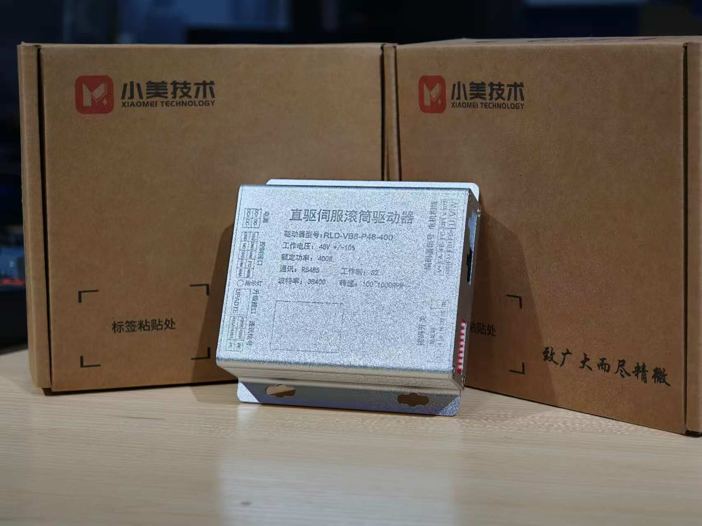

# PLD-V88-P48-400 直驱伺服滚筒驱动器

**PLD-V88-P48-400 直驱伺服滚筒驱动器**属于**物流系统控制器**系列，面向物流分拣、输送线及 AGV 等自动化输送场景，采用 **FOC（磁场定向控制）**算法，为有感无刷滚筒电机提供速度闭环与位置闭环控制。支持 **24V 200W 或 48V 400W** 功率输出，采用铝合金外壳散热，并提供 RS485 通信与控制信号接口，便于接入现场控制系统。

## 配套与独立使用

**[PE3237 小车控制器](./PE3237)**与 **PLD-V88-P48-400 直驱伺服滚筒驱动器**可配套组成**一套物流控制与驱动方案，也可根据应用需求分别使用**。

- **配套使用**：PLC 通过 PROFINET 连接 PE3237，PE3237 通过 RS485 与 PLD-V88-P48-400 通信，由驱动器完成滚筒电机的速度或位置控制。
- **独立使用**：PE3237 可连接其他采用匹配驱动协议的 RS485 设备；PLD-V88-P48-400 可通过自身控制接口接入其他控制系统。接入时需匹配通信协议与接口参数。

## 应用

适用于物流分拣线、物流输送线及 AGV 等输送场景中的有感无刷滚筒电机驱动。

## 规格介绍
- **铝合金外壳材质，增强散热**
- **电源支持 24V 200W 或者 48V 400W**
- **使用FOC算法控制，提供速度闭环、位置闭环等控制**
- **控制信号有2个信号输入，1个信号输出**
- **1路RS485接口、1路固件升级接口、无刷电机UVW端口、ABZ3相差分位置传感器接口**
- **8位拨码盘**

[返回物流系统控制器](./#物流系统控制器)
