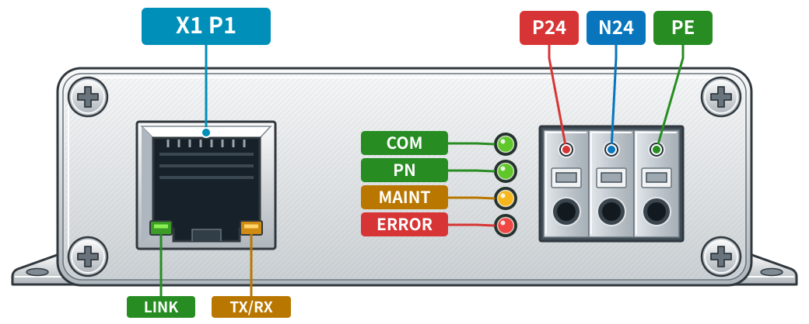
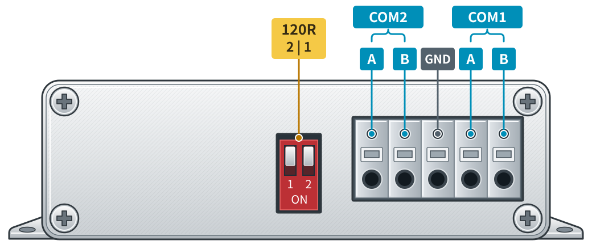

# PE3237 小车控制器

**PE3237 小车控制器** 属于**物流系统控制器**系列，面向物流小车控制应用，通过 **PROFINET** 接入 PLC，并通过 **2/4 路 RS485** 与现场驱动设备交换控制指令和运行状态。各路可独立配置，用于连接采用匹配驱动协议的设备。

制造商：**小美技术（东莞）有限公司** · Xiaomei Technology (Dongguan) Co., Ltd.

## 配套与独立使用

**PE3237 小车控制器**与 **[PLD-V88-P48-400 直驱伺服滚筒驱动器](./DC%20Servo%20Roller%20Driver)** 可配套组成**一套物流控制与驱动方案，也可根据应用需求分别使用**。

- **配套使用**：PLC 通过 PROFINET 连接 PE3237，PE3237 通过 RS485 与 PLD-V88-P48-400 通信，由驱动器完成滚筒电机的速度或位置控制。
- **独立使用**：PE3237 可连接其他采用匹配驱动协议的 RS485 设备；PLD-V88-P48-400 可通过自身控制接口接入其他控制系统。接入时需匹配通信协议与接口参数。

## 产品功能

- **PROFINET 接入**：提供一个百兆以太网接口，支持设备发现、站名与 IP 分配、周期过程数据交换和在线定位闪灯。
- **独立串口通道**：RS485 路数按供货型号配置；软件最多支持 4 路，各路分别设置波特率、驱动类型与节点数量。
- **按需组态**：PLC 中按实际接线插入 CD-00B1 模块，未使用的槽位可留空；每路输入、输出各 20 字节。
- **运行状态可视**：ERROR、MAINT、PN、COM 四个指示灯区分网络、PLC、串口活动和维护状态。

## 外观与接口定义

下图为 **两路 RS485 版本**，按正面、背面分别展示接口位置。面板以银色铝合金示意，接口顺序以图中观察方向为准。

<figure class="pe3237-pinout">
  <figcaption><strong>正面</strong>PROFINET · 电源 · 状态指示</figcaption>
  

    
  

</figure>

<figure class="pe3237-pinout">
  <figcaption><strong>背面</strong>RS485 · 终端电阻</figcaption>
  

    
  

</figure>

接口图按屏幕宽度整体缩放，无需横向滑动；需要看清细节标注时，可在手机上双指放大页面。

| 面板 | 标识 | 接口定义 |
| --- | --- | --- |
| 正面 | **X1 P1** | PROFINET 网络接口（RJ45） |
| 正面 RJ45 | **LINK / TX/RX** | 左侧绿色 LINK 表示物理链路，右侧琥珀色 TX/RX 表示以太网收发活动 |
| 正面 | **P24 / N24 / PE** | 三位电源端子，面向正面从左至右排列 |
| 正面 | **COM / PN / MAINT / ERROR** | 从上到下排列，颜色依次为绿色、绿色、琥珀色、红色 |
| 背面 | **120R** | 终端电阻拨码开关，图中按 `2 / 1` 标注 |
| 背面 | **COM2 A / COM2 B / GND / COM1 A / COM1 B** | 五位 RS485 端子，面向背面从左至右排列，中间端子为 GND |

指示灯在图中仅表示位置与颜色，运行含义见[指示灯状态](#指示灯状态)。四路型号按实际装配接口接线。

## GSD 文件下载

以下 GSDML 对应 **PE3237 固件 v1.2.4**，用于 TIA Portal 等工程软件中的设备识别与硬件组态。推荐下载 ZIP，解压后选择其中的 XML 文件安装。

**[下载 GSD 文件（ZIP）](/downloads/pe3237/v1.2.4/PE3237-GSDML-V1.2.4.zip)** · [下载 GSDML 原文件（XML）](/downloads/pe3237/v1.2.4/GSDML-V2.35-PE3237-CD00B1-20261031.xml)

下载后可核对以下 **MD5**，确认文件内容一致：

| 下载文件 | MD5 |
| --- | --- |
| ZIP 压缩包 | `b7ac775d4172b0ba8426d6b98f54a9a0` |
| XML 原文件 | `c74db84e9c93c1505d0dba0142cf0ffb` |

| 项目 | 内容 |
| --- | --- |
| 适用产品 | PE3237 小车控制器 / PROFINET–RS485 网关 |
| GSD 文件 | `GSDML-V2.35-PE3237-CD00B1-20261031.xml` |
| 文件日期 | 2026-10-31 |
| GSDML 格式 | V2.35 |
| 软件版本 | V1.2.4 |
| 硬件版本 | 1 |
| VendorID / DeviceID | `0x1018` / `0x0417` |
| RS485 默认驱动 | HME Driver，参数值 `1` |

**GSDML V2.35 是文件格式版本，V1.2.4 是设备软件版本。**

## PLC 组态与通信参数

### 槽位与过程数据

| PLC 槽位 | 模块 / 接口 | PLC 输入 | PLC 输出 |
| --- | --- | --- | --- |
| 0 | 固定设备接入点 DAP | 无串口业务数据 | 无串口业务数据 |
| 1 | CD-00B1 / RS485-1 | 20 字节 | 20 字节 |
| 2 | CD-00B1 / RS485-2 | 20 字节 | 20 字节 |
| 3 | CD-00B1 / RS485-3 | 20 字节 | 20 字节 |
| 4 | CD-00B1 / RS485-4 | 20 字节 | 20 字节 |

输入、输出方向以 PLC 为参照。四路全部配置时，业务数据合计为 **80 字节输入、80 字节输出**。槽号与物理串口固定对应：例如只配置槽 2 和槽 4，使用的就是 RS485-2 与 RS485-4，不会重新编号。

两路型号仅配置实际装配的接口，未使用槽位留空。每路通信参数应与所连接设备保持一致：

| 参数 | 默认值 / 设置说明 |
| --- | --- |
| 波特率 | 默认 `38400 bit/s`；参数为 `0` 时保持该路当前值 |
| 串口格式 | 8 数据位、无校验、1 停止位（8N1） |
| 驱动类型 | 默认 HME Driver（`1`）；根据从站协议选择 |
| 节点数量 | 可设 `0–32`，按实际设备配置 |

### TIA Portal 安装与调试

1. **安装 GSD**：解压下载文件，在“选项 → 管理通用站描述文件（GSD）”中选择 XML 所在目录并安装，随后更新硬件目录。
2. **添加设备**：在硬件目录中查找 **PE3237 四路 PROFINET / RS485 网关**，核对订货号 PE3237 和软件版本 V1.2.4。
3. **分配网络**：选择连接设备的网卡，通过在线访问发现设备；按 MAC 地址确认目标，再分配与工程一致的 PROFINET 站名和 IP。需要时使用“闪烁 LED”定位实物。
4. **配置串口模块**：在实际使用的槽位插入 CD-00B1，设置每路波特率、驱动类型和节点数量，并核对 PLC 的输入 / 输出地址。
5. **检查运行状态**：编译、下载工程并建立连接。PLC RUN 且周期数据有效、无故障时，PN 绿灯常亮、ERROR 熄灭；串口有有效活动时 COM 亮起。

已有工程安装新 GSD 后，不一定自动更新设备对象。请同时核对工程中的设备版本、槽位和参数，尤其是 **HME Driver（1）**；不要仅凭 GSD 文件日期判断是否已完成更新。

## 指示灯状态

通过 ERROR（红色）、MAINT（琥珀色）、PN（绿色）和 COM（绿色）四个指示灯查看运行、通信、维护及错误状态。

| 状态 | ERROR · 红 | MAINT · 琥珀色 | PN · 绿 | COM · 绿 |
| :--- | :---: | :---: | :---: | :---: |
| 初始化 | 灭 | 灭 | 2 Hz | 灭 |
| 无网络链路 | 常亮 | 有警告时 1 Hz | 灭 | 活动脉冲 |
| 等待 PLC 连接 | 1 Hz | 有警告时 1 Hz | 灭 | 活动脉冲 |
| PLC RUN 正常 | 灭 | 灭 | 常亮 | 活动脉冲 |
| PLC STOP，连接保留 | 灭 | 有警告时 1 Hz | 1 Hz | 活动脉冲 |
| 组态错误／串口初始化失败／BAD IOPS，链路正常 | 2 Hz | 有警告时 1 Hz | 灭 | 活动脉冲 |
| RS485 超时／从站报警，PN 正常 | 灭 | 1 Hz | 常亮 | 活动脉冲 |
| Flash 存储失败，PN 正常 | 灭 | 1 Hz | 常亮 | 活动脉冲 |
| 维护模式／串口诊断／小车模拟 | 灭 | 2 Hz | 灭 | 灭 |
| 致命错误／服务超时保护 | 常亮 | 灭 | 灭 | 灭 |
| DCP 定位闪灯 | 保留原状态 | **5 Hz** | **5 Hz** | **5 Hz** |

### 闪烁频率与活动含义

| 显示方式 | 含义 |
| --- | --- |
| 1 Hz 慢闪 | 亮 500 ms、灭 500 ms |
| 2 Hz 快闪 | 亮 250 ms、灭 250 ms |
| 5 Hz 定位闪烁 | 亮 100 ms、灭 100 ms |
| COM 活动脉冲 | 任一路发送完成或收到有效应答后亮约 80 ms；连续活动可表现为常亮 |

DCP 定位期间，ERROR 保留原状态，MAINT、PN 和 COM **同步以 5 Hz 闪烁**；停止定位请求后，最长约 3 秒恢复原有灯语。定位闪灯用于寻找设备，不表示通信故障。

COM 仅表示串口活动，不单独证明一次控制事务已成功。PLC STOP 若同时释放连接，设备会转为“等待 PLC 连接”的红灯 1 Hz 状态。网口左侧绿色 LINK 灯反映物理链路，右侧琥珀色 TX/RX 灯反映以太网收发活动。

## 常见问题

| 现象 | 检查方向 |
| --- | --- |
| 能扫描到设备，但无法读取在线信息 | 检查所选网卡、电脑与设备的 IP / 子网及实际连通性；DCP 可发现设备不代表 TCP 已可达 |
| ERROR 红灯常亮、PN 熄灭 | 先检查网线、交换机和网口 LINK；若链路正常仍持续出现，检查设备是否进入错误保护 |
| ERROR 红灯 1 Hz 慢闪 | 检查 PLC 是否已建立连接，站名、IP 和工程配置是否一致 |
| ERROR 红灯 2 Hz 快闪 | 检查模块槽位、输入 / 输出长度、串口参数和过程数据有效状态 |
| PN 常亮、MAINT 1 Hz 慢闪 | 检查 RS485 接线、从站地址、波特率与协议，再检查从站报警或参数存储状态 |
| 黄灯和两颗绿灯同步 5 Hz 闪烁 | 设备正在执行定位请求，停止定位后等待恢复 |
| 博途“制造商描述”为空 | 核对在线设备的 VendorID、序列号和固件版本；该栏名称显示还需核对工程软件的厂商映射，不能单凭此栏判断 PROFINET 通信是否正常 |

[返回物流系统控制器](./#物流系统控制器)

