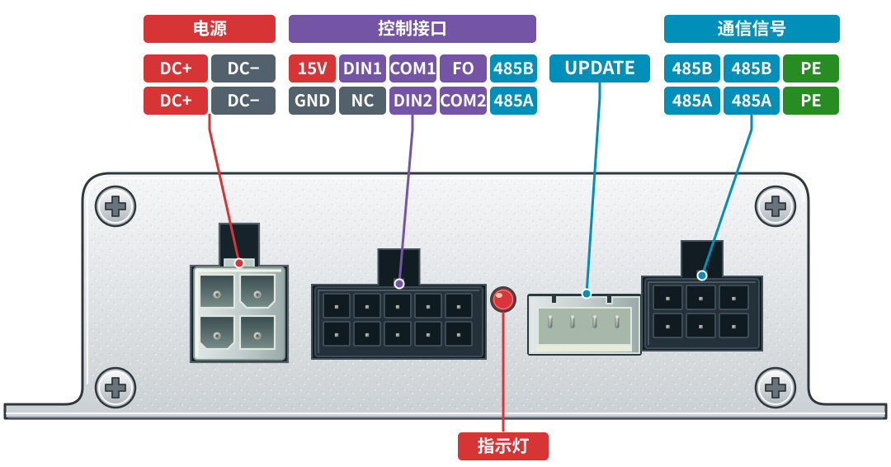
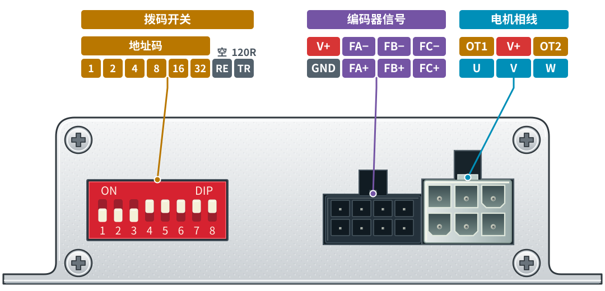

# RLD-VB8-P48-400 直驱伺服滚筒驱动器

**RLD-VB8-P48-400 直驱伺服滚筒驱动器**属于**物流系统控制器**系列，面向物流分拣、输送线及 AGV 等自动化输送场景，采用 **FOC（磁场定向控制）**算法，为有感无刷滚筒电机提供速度闭环与位置闭环控制。支持 **24V 200W 或 48V 400W** 功率输出，采用铝合金外壳散热，并提供 RS485 通信与控制信号接口，便于接入现场控制系统。

## 外观与接口定义

<figure class="roller-pinout">
  <figcaption><strong>电源与控制面</strong>电源 · 控制接口 · 指示灯 · 升级 · 通信</figcaption>
  

    
  

</figure>

<figure class="roller-pinout">
  <figcaption><strong>电机与编码器面</strong>拨码开关 · 编码器信号 · 电机相线</figcaption>
  

    
  

</figure>

### 电源、控制与通信接口

| 接口 | 上排（从左至右） | 下排（从左至右） |
| --- | --- | --- |
| 电源 | DC+ / DC− | DC+ / DC− |
| 控制接口 | 15V / DIN1 / COM1 / FO / 485B | GND / NC / DIN2 / COM2 / 485A |
| 通信信号 | 485B / 485B / PE | 485A / 485A / PE |

**UPDATE** 为固件升级接口；其左侧为指示灯。

### 编码器、电机与拨码

| 接口 | 上排（从左至右） | 下排（从左至右） |
| --- | --- | --- |
| 编码器信号 | V+ / FA− / FB− / FC− | GND / FA+ / FB+ / FC+ |
| 电机相线 | OT1 / V+ / OT2 | U / V / W |

8 位拨码从左至右的标识为 **1、2、4、8、16、32、RE、TR**，各位含义如下：

| 位 | 标识 | 含义 |
| :--- | :--- | :--- |
| 1–6 | 1 / 2 / 4 / 8 / 16 / 32 | 地址码权重位，按位叠加得到设备地址 |
| 7 | **RE** | **Reserved**，保留位，保持关闭 |
| 8 | **TR** | **终端电阻开关**（120 Ω），用于 RS485 总线末端阻抗匹配 |

**地址规则**：地址 `0` 为**广播地址**，设备地址设置为 **1–31**，因此地址码按 1、2、4、8、16 叠加，权重位 32 保持关闭。

图中 **RE**、**TR** 与电机接口 **OT1 / OT2** 沿用机壳丝印标识。

## 配套与独立使用

**[PE3237 小车控制器](./PE3237)**与 **RLD-VB8-P48-400 直驱伺服滚筒驱动器**可配套组成**一套物流控制与驱动方案，也可根据应用需求分别使用**。

- **配套使用**：PLC 通过 PROFINET 连接 PE3237，PE3237 通过 RS485 与 RLD-VB8-P48-400 通信，由驱动器完成滚筒电机的速度或位置控制。
- **独立使用**：PE3237 可连接其他采用匹配驱动协议的 RS485 设备；RLD-VB8-P48-400 可通过自身控制接口接入其他控制系统。接入时需匹配通信协议与接口参数。

## 应用

适用于物流分拣线、物流输送线及 AGV 等输送场景中的有感无刷滚筒电机驱动。

## 规格介绍
- **铝合金外壳材质，增强散热**
- **电源支持 24V 200W 或者 48V 400W**
- **使用FOC算法控制，提供速度闭环、位置闭环等控制**
- **控制信号有2个信号输入，1个信号输出**
- **1路RS485接口、1路固件升级接口、无刷电机UVW端口、ABZ3相差分位置传感器接口**
- **8位拨码盘**

[返回物流系统控制器](./#物流系统控制器)

