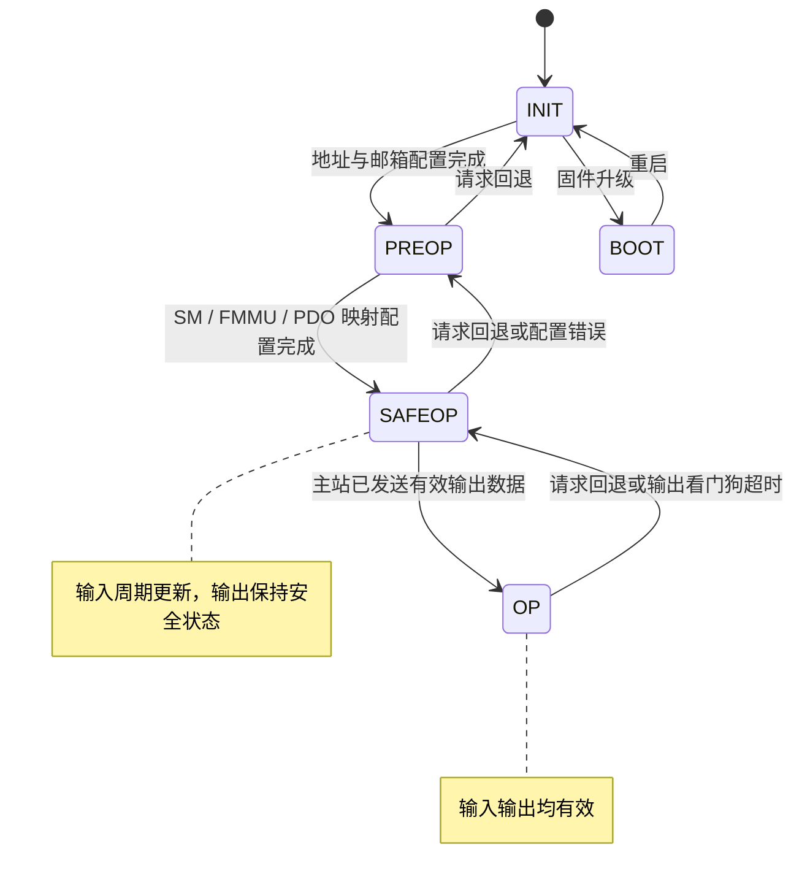
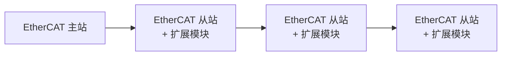
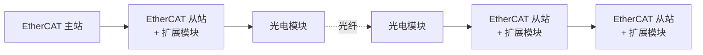
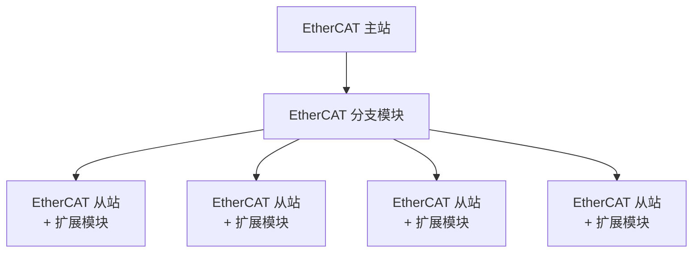
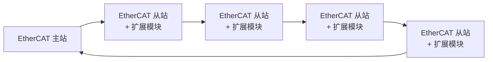

# EtherCAT 总线介绍

## 简介

EtherCAT 是一种基于以太网的现场总线系统，主要用于工业自动化领域的数据传输。其独特的通信方式突破了其他以太网解决方案的系统限制，使得数据传输更加高效。在 EtherCAT 网络中，数据通过一个环形或线性的网络结构传递，每个从站设备都会读取和写入数据，然后立即将数据包传递给下一个从站，网段内的最后一个从站设备将完全处理的数据帧作为响应帧发给主站。

EtherCAT 采用主从通信模式，即一个 EtherCAT 主站与多个 EtherCAT 从站进行通信。主站负责发送数据帧并接收从站的响应，而从站则负责接收主站的数据帧并执行相应的操作，然后将结果数据写入数据帧中返回给主站。这种传输方式能够在一个周期内实现数据通信，显著提高了带宽利用率。

EtherCAT 的技术特点包括**实时性**、**灵活性**和**高效性**。它支持多种设备连接拓扑结构，如环形和线性结构，从站节点使用专用的控制芯片，具有低延时和精准同步的特点，非常适合工业自动化应用。

EtherCAT 数据直接使用以太网数据帧传输，数据帧使用帧类型 `0x88A4`。EtherCAT 数据报文是由 2 个字节的数据头（EtherCAT 头）和 44 字节～1498 字节的 EtherCAT 数据组成。数据区由一个或多个 EtherCAT 子报文组成，每个子报文对应独立的设备或从站存储区域，主站使用不同的寻址方式通过 EtherCAT 子报文和从站设备完成数据交换。

## EtherCAT 通信类型

EtherCAT 通信类型主要包括**过程数据对象（PDO）**和**服务数据对象（SDO）**。PDO 用于周期性的数据交换，而 SDO 用于非周期性的数据交换。

### 过程数据通信（PDO 通信）

PDO 通信是 EtherCAT 总线网络中周期性进行主站与从站数据交互的功能。它主要用于周期性数据读取和控制，读写速度快，主站和从站通过 PDO 进行数据交换时，一方发送数据后，另一方不需要应答。PDO 列表可以看作一个数组空间，每个数组元素存放不同的功能码，这些功能码在一个周期中执行对应的操作。

### 服务数据通信（SDO 通信）

SDO 通信是一种请求应答式的数据交换方式，也称为邮箱通信，用于非周期性数据的配置和状态信息的读取。当需要进行非周期性数据交换时，主站会通过 SDO 发送一个请求，从站响应这个请求并返回数据。SDO 主要用于设备的配置和诊断等需要应答的数据交换。

## EtherCAT 通信

### 基于 EtherCAT（CoE）的 CAN 应用协议结构

在结构图中应用层对象字典里包含通信参数、应用程序数据，以及 PDO 的映射数据等。PDO 过程数据对象，包含了设备运行过程中的实时数据，且以周期性地进行读写访问。SDO 邮箱通信，则以非周期性地对一些通信参数对象、PDO 过程数据对象，进行访问修改。

- 继承了 CANopen 的对象字典概念，便于设备参数的统一管理。
- 支持 SDO（服务数据对象）和 PDO（过程数据对象）通信。
- 常用于传感器、执行器等设备的实时数据交换和配置。

### EtherCAT 设备描述文件（ESI 文件）

在 EtherCAT 中，ESI 设备描述文件是一个 XML 格式的文件，用于描述从站设备的配置和功能，它包含了从站设备的硬件和软件参数，以及和其它从站之间的通信规则。

该描述文件可以用于配置和识别 EtherCAT 网络中的从站设备，并确保网络中的所有设备能够正确地进行数据交换和协同工作。

### EtherCAT 通信状态转换

EtherCAT 设备必须支持 4 种状态，负责协调主站和从站应用程序在初始化和运行时的状态关系：

| 状态 | 简写 | 说明 |
|------|------|------|
| **Init** | I | 初始化 |
| **Pre-Operational** | P | 预运行 |
| **Safe-Operational** | S | 安全运行 |
| **Operational** | O | 运行 |

从初始化状态向运行状态转化时，必须按照 **初始化 → 预运行 → 安全运行 → 运行** 的顺序转化，不可以跳流程。从运行状态返回时可以跳流程转化。

| 状态和状态转化 | 操作 |
|--------------|------|
| 初始化（I） | 应用层无通信，主站只能读写 ESC 寄存器 |
| I→P | 主站配置从站站点地址；配置邮箱通道；配置 DC 分布式时钟；请求"预运行"状态 |
| 预运行（P） | 应用层邮箱数据通信（SDO） |
| P→S | 主站使用邮箱初始化过程数据映射；主站配置过程数据通信使用的 SM 通道；主站配置 FMMU；请求"安全状态" |
| 安全运行（S） | 有过程数据通信，但只更新输入数据（TxPDO），输出保持安全状态；仍可使用邮箱通信（SDO） |
| S→O | 主站发送有效的输出数据以请求"运行状态" |
| 运行状态（O） | 输入和输出全部有效，仍然可以使用邮箱通信（SDO、TxPDO、RxPDO） |
| I→B | 进入引导状态 |
| 引导状态（B） | 可进行 FoE 通信，提供文件传输服务，实现固件升级 |
| B→I | 重启设备 |

> 各状态下 DI / DO 的实际行为、ERROR 标志与故障输出策略，详见文末 [状态与故障 FAQ](#状态与故障-faq)。

### 过程数据对象（PDO）

#### 简介

过程数据对象（PDO）用于主站和从站之间的周期性数据交换。

- **输入过程数据对象（TxPDO）**：用于从站向主站反馈自身的状态。
- **输出过程数据对象（RxPDO）**：用于从站接收主站的指令。

#### PDO 映射

PDO 映射（PDO Mapping）用来映射需要通信的过程数据对象字典。映射类型分为接收 PDO 映射和发送 PDO 映射，两者的索引范围分别为 `0x1600`-`0x17FF` 和 `0x1A00`-`0x1BFF`。

用于进行 PDO 映射的对象字典，其值为需要进行 PDO 通信的过程数据对象字典索引、子索引和对象字典数据长度，基本组成如下：

| bit（位） | 31 … 16 | 15 … 8 | 7 … 0 |
|-----------|---------|--------|-------|
| 含义 | 索引 | 子索引 | 对象长度 |

索引和子索引共同决定对象在对象字典中的位置，对象长度指明该对象的具体位长，用十六进制表示：

| 位长 | 对象长度 |
|------|----------|
| 8 位 | `08h` |
| 16 位 | `10h` |
| 32 位 | `20h` |

#### PDO 分配

PDO 分配（PDO Assignment）用于配置 PDO 映射，PDO 分配分为接收 PDO 分配和发送 PDO 分配两个对象字典，两者的对象字典分别为 `0x1C12` 和 `0x1C13`。

### 服务数据对象（SDO）

在 EtherCAT 网络中，服务数据对象（SDO）是一个在 EtherCAT 从站和主站之间交换的数据结构，用于从机的配置、状态信息的通信和应用层数据的交换。SDO 可以用于在 EtherCAT 网络中传输从站的配置参数，如硬件配置、操作参数等。

### EtherCAT 主站和从站之间的通信

在 EtherCAT 网络中，主站和从站之间的时间同步是一个关键问题。EtherCAT 提供了三种同步模式：

- **自由运行模式（Free Run）**：此模式下，从站内的控制周期由本地定时器产生，因为 EtherCAT 网络中各个从站开始运行的时间不同，所以每个从站按照自己的运行周期刷新 IO，属于异步运行。

- **SM 同步模式（Sync Manager）**：指通过 SM 通道来实现数据同步的模式，主站下发的数据帧到达从站时，会触发同步管理器事件；当从站接收到该信号后，会立即进入中断服务程序中执行数据交换和 IO 刷新。此模式下，因为数据帧到达各个从站的时间不同，所以每个从站接收到数据存在时间差，从站越多、组态越复杂的系统同步效果越差。

- **DC 同步模式（Distributed Clock，分布式时钟）**：指分布式时钟同步模式，主站周期性读取支持 DC 同步功能从站的本地时钟（一般是网络中支持 DC 同步功能的第一个从站），然后将该时钟作为系统时钟周期性下发给其它从站，其它从站在接收到系统时钟后和自身时钟进行比较，根据时间偏差动态补偿调整自身时钟，从站通过 SYNC0 产生精确的同步信号并触发中断，从而控制各设备任务的同步执行。

### EtherCAT 从站寻址

EtherCAT 从站支持不同的寻址模式，在 EtherCAT 数据帧的帧头中有一个 32bit 的地址，用于实现物理节点寻址或逻辑寻址。

一个 EtherCAT 网段相当于一个以太网设备，EtherCAT 数据通过以太网帧进行传输，主站通过以太网帧首部的 MAC 目的地址寻址到 EtherCAT 网段，该过程即为**网段寻址**。

#### 设备寻址

在设备寻址时，EtherCAT 子报文内的 32 位地址分为 16 位从站设备地址和 16 位从站设备内部物理存储空间地址（从站内存偏移地址）。16 位从站设备地址可以寻址 65535 个从站设备，每个设备内最多可以有 64K 字节的内部存储空间。设备寻址时，每个子报文只寻址唯一的从站设备。

#### 逻辑寻址

逻辑寻址时，子报文内的 32 位地址是一个整体，表示逻辑地址，整个 EtherCAT 网段内的设备数据交换区地址通过 FMMU 映射到逻辑地址。数据通信时，主站不会区分具体设备地址，而是将整个 EtherCAT 网段当做一个数据存储空间进行访问，这种方式不需要复杂的内存映射，可以直接在网段内进行数据传输，极大地提高了数据传输速率，逻辑寻址方式特别适用于周期性交换数据。

#### 位置寻址（自动增量寻址）

从站的地址由其在网段内的连接位置确定，在网络启动阶段，主站发送带有负数地址的报文，报文经过从站时，其位置地址加 1，当地址为 0 时表明寻址到自己的报文，这种寻址方式也称为**自动增量寻址（Auto Increment Addressing）**。主站通过位置寻址的方式设置从站的站点地址（例如 1001、1002 等），然后从站可以使用与物理位置无关的站点地址来寻址从站。

#### 节点寻址（设置寻址）

节点寻址时，从站的地址和连接位置无关，主站通过站点地址或站点地址别名寻址到具体的设备，然后根据设备内的偏移地址（Offset Address）访问数据，节点寻址又称为**设置寻址**。

EtherCAT 通信接口模块支持站点地址别名功能，站点地址是在网络启动过程中，由主站通过位置寻址的方式自动设置给从站，站点地址别名在上位机上进行设置和启用，优先级高于站点地址，主站可以选择采用哪种地址进行节点寻址，默认使用站点地址方式。

> **注意**：部分通信接口模块只可通过上位机设置站点地址别名。

### 网络设备简介

| 网络设备/文件名称 | 描述 |
|------------------|------|
| EtherCAT 主站 | EtherCAT 网络中的管理者，网络中的数据都由主站主动发起。 |
| EtherCAT 从站 | EtherCAT 网络中的执行者，主要负责实时数据交换和控制逻辑的实现。 |
| 扩展模块 | 可挂载到通信接口模块或主站上的功能模块，执行主站下发的控制指令，刷新 IO。 |
| ESI 文件 | 即 EtherCAT 从站信息文件，是一个 XML 配置文件，包含了从站提供的功能和属性信息。主站需要通过这个文件对从站进行初始化设置。 |
| EDS 文件 | 即 EtherNet/IP 从站信息文件，是一个 XML 配置文件，包含了从站提供的功能和属性信息。主站需要通过这个文件对从站进行初始化设置。 |
| GSD 文件 | 即 PROFINET 从站信息文件，是一个 XML 配置文件，包含了从站提供的功能和属性信息。主站需要通过这个文件对从站进行初始化设置。 |
| 上位机配置软件 | 在电脑端运行的工业上位机软件，用于 EtherCAT 网络和主从站的配置，以及 PLC 软件编程、状态监控和故障排除。 |
| 通信线缆 | 用于 EtherCAT 数据帧传输，使用以太网超 5 类（100Base-TX）或更高的屏蔽双绞线，使用直线布线。 |
| EtherCAT 分支模块 | 用于在多轴复杂设备和产线组网中搭建星型拓扑组网（不支持环型拓扑）。 |
| 光电转换模块 | 用于以太网和光纤之间的转换，通过 EtherCAT 总线实现远距离通信，网线超过 100 米后可采用该模块增加通信距离。 |
| 光纤 | 用于在光纤模块之间进行远距离数据传输。 |

### 典型网络拓扑

本节提供典型的 EtherCAT 网络配置示例，包括线型、星型和环型拓扑结构，线型支持近距离直连通信和通过光纤模块远距离通信。

#### 线型（近距离通信）

#### 线型（远距离通信）

#### 星型

#### 环型

## 状态与故障 FAQ

::: tip 本节说明
本节说明 EtherCAT 从站状态机（INIT / PRE-OP / SAFE-OP / OP 及叠加的 ERROR 标志）对**数字量输入 DI** 与**数字量输出 DO** 的真实含义，用于排查“主站显示 OP 但端子不动作”“断网后输出保持不动”“SAFE-OP 能不能用输入做联锁”等问题。厂家行为以对应型号手册为准。
:::

### 一分钟结论

| 主站看到的状态 | 输入（DI） | 输出（DO） |
| :--- | :--- | :--- |
| **INIT** | 无周期输入数据，主站读到的是无效值 | 不跟随主站命令，通常为关断 |
| **PRE-OP** | 无周期输入数据，主站读到的是无效值或旧值 | 保持安全状态，普通 DO 通常为 OFF |
| **SAFE-OP** | **周期更新，主站可读到当前输入** | 主站数据已收到但**不输出到端子**，保持安全状态 |
| **OP** | 周期更新 | **按主站有效输出数据动作** |
| **ERROR（叠加标志）** | 视错误类型，可能继续更新、可能停止 | 视故障类型与型号参数，常见为关断或替代值，也有型号可保持最后值 |

### 各状态下的通信与 I/O 行为

| 状态 | 邮箱通信（SDO） | 输入过程数据（TxPDO） | 输出过程数据（RxPDO） | 数字量输入 DI | 数字量输出 DO |
| :--- | :--- | :--- | :--- | :--- | :--- |
| **INIT** | 不可用，只能访问 ESC 寄存器 | 不交换 | 不交换 | 现场电平可能已采样，指示灯可能亮，但主站无输入数据 | 输出级不随主站命令动作，通常关断 |
| **PRE-OP** | 可用 | 不交换 | 不交换 | 同上，主站变量为无效值或旧值 | 保持安全状态，普通 DO 通常为 OFF |
| **SAFE-OP** | 可用 | **周期更新** | 主站可写，从站不送到端子 | **有效，可用于判断现场状态** | 保持安全状态，普通 DO 通常为 OFF |
| **OP** | 可用 | 周期更新 | 周期更新并输出 | 有效 | **跟随主站输出命令** |
| **BOOT** | 仅 FoE 文件传输 | 不交换 | 不交换 | 无 | 保持安全状态 |

::: warning 关键结论
**SAFE-OP 下输入已经在周期更新，输出不会跟随主站命令。** 主站在 SAFE-OP→OP 之前必须先发送有效输出数据，但这只是“允许进入 OP 的条件”，不代表端子此时会动作。
:::

**INIT**：上电或复位后的初始状态。无邮箱通信、无过程数据通信，主站只能读写 ESC 寄存器（类型、版本、DL 状态等）。主站在此阶段完成站点地址、邮箱 SyncManager（SM0/SM1）与 DC 分布式时钟配置，然后请求进入 PRE-OP。

**PRE-OP（预运行）**：邮箱通信（SDO）可用，用于读写对象字典、配置 PDO 映射与 SyncManager PDO 分配；过程数据不交换，主站收不到新输入，也写不到输出。

**SAFE-OP（安全运行）**：过程数据通信已建立，输入 PDO 周期更新，主站可以读到真实输入；输出 PDO 也可以写入，但从站保持输出在安全状态，不把数据送到端子。主站组态里能看到输出变量已经“写进去”，但端子不会动作，直到成功进入 OP。

**OP（运行）**：输入输出均有效，从站把主站下发的输出数据复制到端子，同时继续更新输入；仍可使用邮箱通信做参数读写与诊断。

**BOOT**：仅用于固件升级，只支持 FoE 文件传输，无过程数据；只能由 INIT 进入，升级完成后回到 INIT。

### ERROR 是叠加标志，不是第五个基本状态

错误通常显示为 `PREOP+ERROR`、`SAFEOP+ERROR`，而不是独立的“ERROR 状态”。例如主站请求 SAFE-OP 失败，从站会置错误标志，界面显示 `ERR PREOP`——**当前状态仍是 PRE-OP**。排查时要同时看三样东西：实际状态、错误标志、AL Status Code。

| AL Status Code | 含义 | 常见原因 |
| :--- | :--- | :--- |
| `0x0011` | 请求的状态转换非法 | 主站跳级请求、状态机顺序错误 |
| `0x0016` | 邮箱配置无效 | SM0/SM1 参数、邮箱长度或协议配置错误 |
| `0x0017` | SyncManager 配置无效 | SM2/SM3 长度或方向配置错误 |
| `0x001B` | SM 看门狗超时 | 主站停止发送过程数据 |
| `0x001D` | 输出配置无效 | 输出映射长度与 SM 长度不匹配 |
| `0x001E` | 输入配置无效 | 输入映射长度与 SM 长度不匹配 |
| `0x0024` / `0x0025` | 输入 / 输出 PDO 映射无效 | ESI 与实际固件映射不一致 |
| `0x0030` | DC SYNC 配置无效 | 同步周期、SYNC0/SYNC1 参数不匹配 |
| `0x0052` | 从站本地重启 | 掉电、复位、固件异常 |

> 上述代码定义见 ETG.1020，各厂家可能使用自定义区间（如 `0x8000` 以上）；具体解释以设备手册为准。

主站“清除错误”（Clear Error，对应 AL Control `0x0120` 的 Acknowledge 位）只清除错误标志，**当前状态不会因此前进**。清除后设备仍停在 PRE-OP 或 SAFE-OP，必须由主站重新请求状态转换，并满足转换条件，才能重新进入 OP；若根因未消除，错误会再次出现。

### 状态与数字量输入 DI

排查输入问题时，务必区分三层含义：

| 层次 | 表现 | 是否可信 |
| :--- | :--- | :--- |
| 现场电平 | 传感器、按钮的实际通断 | 真实物理量 |
| 模块本地采样 | 端子上的输入指示灯 | 只反映模块采样，**不等于主站已收到** |
| 主站过程数据映像 | PLC 变量中的值 | 只有在输入 PDO 正常更新时才有效 |

- **PRE-OP / INIT**：外部信号仍可能让 DI 指示灯亮，但主站没有周期输入更新，PLC 变量可能是 0，也可能停留在断开前的最后一次值。
- **SAFE-OP / OP**：输入正常周期更新，可以用于逻辑判断。
- **通信中断后**：PLC 变量通常冻结在最后一次的值，**不能当作当前输入**。这也是部分厂家提供“输入数据无效”标志的原因。

::: caution 不要用指示灯替代程序里的有效性判断
指示灯亮只说明模块采到了电平，不说明主站拿到了数据。程序侧应同时判断：从站状态是否为 OP、是否有错误标志、输入数据是否在有效刷新。
:::

### 状态与数字量输出 DO

输出是否动作取决于从站状态与故障策略，而不是“主站有没有写过输出变量”。SAFE-OP 的意义正是让主站先校验输入映射，同时不让输出影响现场：

- 主站写进 RxPDO 的数据在 SAFE-OP 下被从站丢弃或保持，不会驱动端子；
- 只有进入 OP 后，从站才把输出数据复制到输出级；
- 主站必须在请求 OP 之前就发送有效输出数据，否则从站可以拒绝进入 OP——这是为了防止“刚进 OP 就用默认 0 或旧值冲击现场”。

输出故障处理通常分两级：

| 监测机制 | 触发条件 | 典型行为 |
| :--- | :--- | :--- |
| **CycleCounter / 丢帧监测** | 一个或数个周期没有新数据 | 继续使用缓冲区数据，并按配置选择输出 0、输出 1、保持、继续或高阻（依型号支持） |
| **SM Watchdog（过程数据看门狗）** | 超过设定时间没有有效过程数据 | 执行故障输出策略，从站回到 SAFE-OP(+ERROR)，等待主站恢复 |

SM Watchdog 常见默认值为 100 ms，可按周期倍数放大；上限与截断规则依型号而定（如 Beckhoff EL4374 最大约 65 s，超出按模运算截断）。

| 时间点 | 从站本地状态 | DO 实际输出 | 主站侧 |
| :--- | :--- | :--- | :--- |
| 断线瞬间 | 可能仍显示 OP | **保持最后值** | 通讯中断，变量冻结 |
| 断线后、看门狗未到期 | 仍可能显示 OP | 保持最后值 | 无更新 |
| 看门狗到期 | SAFE-OP(+ERROR) | 执行故障策略：默认多为关断，部分型号可配置替代值或保持 | 恢复通讯后可读到 AL Status |
| 主站重新请求 OP 且数据有效 | OP | 跟随新命令 | 正常 |

如果是**主站主动请求离开 OP**，从站会**立即**执行预定输出策略，不需要等待看门狗。

::: warning 只判断“是不是 OP”不足以判断输出命令有效
断网那一刻，从站本地状态可能暂时仍然是 OP。判断输出是否仍然受控，需要看过程数据是否在刷新（看门狗计数、通讯心跳），而不只是状态字。
:::

### 常见问题

#### 主站显示 OP，但输出端子没有动作，先查什么？

1. **输出 PDO 是否真的映射**：RxPDO 长度、偏移与 SM 长度是否匹配，主站组态与实际 ESI 是否一致。
2. **是否处于 OP 且无错误**：`0x001B`（SM 看门狗）等错误会让输出不刷新。
3. **输出侧负载电源**：DO 模块的负载电源（如 24 V / 0 V）是否接好，PNP / NPN 接线与公共端是否正确。
4. **保护动作**：通道过流、短路或总电流超限时，模块可能关断输出。
5. **程序写的是输出映像**：确认写的是输出地址，而不是被后续逻辑覆盖或写到了输入区。
6. **通道使能 / 参数**：部分模块有通道级使能、诊断或替代值参数，需确认未被关闭。

#### 主站停在 PRE-OP，进不了 SAFE-OP 怎么办？

通常是过程数据配置问题：PDO 映射或 PDO 分配（`0x1C12` / `0x1C13`）与设备支持的不一致；SM2/SM3 的长度、方向、起始地址配置错误；输入输出长度与 ESI 描述不符（换了固件版本但 ESI 未更新）；支持 DC 的设备，DC 参数配置不完整。对应 AL Status Code 常见为 `0x0017`、`0x001D`、`0x001E`、`0x0024`、`0x0025`。

#### 主站停在 SAFE-OP，进不了 OP，输出是什么状态？

输出保持安全状态（普通 DO 通常为 OFF），不会因为主站已经写过输出变量而动作。常见原因：主站没有在请求 OP 前下发有效输出数据；输出看门狗时间过短，主站周期抖动导致误触发；输出映射长度不匹配（`0x001D`）；从站仍在错误状态，需先清除错误。

#### SAFE-OP 下能读到输入吗？可以用来做联锁吗？

**能读到，但不建议作为安全联锁。** SAFE-OP 下输入 PDO 已周期更新，主站可以读取真实输入，这也是主站做输入校验的窗口；但 SAFE-OP 本身表示输出未投入、系统未处于完整运行状态，用输入直接驱动工艺逻辑容易与输出侧状态不一致。急停、超程、人员防护应使用硬线安全回路或安全总线协议，不要只依赖普通 DI 与总线状态。

#### PRE-OP 下 DI 指示灯亮，为什么 PLC 里读不到？

这是正常现象。指示灯反映的是模块本地采样，而 PRE-OP 下没有过程数据交换，主站拿不到新值。PLC 变量可能是初始化值 0，也可能停在断开通信前的最后一次值，不能当作现场状态使用。

#### 拔掉网线后输出保持原状，是模块坏了吗？

不是。断线后从站会在看门狗时间内保持最后值，超过看门狗时间才执行故障输出策略（多数默认关断，部分型号可配置替代值或保持），以避免单帧丢失或瞬时抖动造成输出频繁翻转。若希望“通讯一断立即关断”，可缩短 SM Watchdog 时间（留足抖动余量）、在主站侧做通讯心跳判断主动复位输出，或对安全相关负载使用硬线回路。

#### 主站显示 OP，输出命令就一定有效吗？

不一定。断线瞬间从站本地可能仍显示 OP，输出保持最后值直到看门狗到期。判断输出命令是否有效，应看过程数据是否持续刷新，而不是只看状态字。

#### 报了 ERROR，点了“清除错误”为什么没有自动回到 OP？

清除错误只清错误标志，不改变当前状态。清除后设备仍停在 PRE-OP 或 SAFE-OP，需要主站重新请求状态转换；若配置错误、映射不匹配、看门狗超时等根因仍在，错误会立刻再次出现。

#### 程序里怎么判断输入数据“当前有效”？

至少做三重判断：从站是否处于 OP 且无错误标志；设备提供的输入无效 / 通讯异常标志是否正常；心跳计数、帧计数或时间戳是否在递增。任一项不满足时，应把输入视为无效并切换到安全逻辑，而不是继续使用冻结值。

#### 可以把“故障保持最后值”作为默认行为吗？

不建议作为默认。保持最后值在连续生产（如张力、流量、加热）中可避免突变，但掉站后现场会长时间维持一个“看起来正常”的状态，风险高；默认关断符合“失效安全”原则，便于发现故障。更稳妥的做法是默认关断，把保持 / 替代值做成显式可配置参数，并在图纸与程序注释中标注。

### 厂家实现参考

| 品牌 / 产品 | 厂家规定或可配置行为 | 依据 |
| :--- | :--- | :--- |
| **Beckhoff EL2262**（数字量输出） | 看门狗触发默认输出 **FALSE**；固件支持按通道配置输出 0、输出 1、保持最后值、继续输出缓冲数据、交替输出，EL2262 还支持输出级高阻 | EL126x 手册 “Explanation of the output behavior in case of error” |
| **Beckhoff EL4374**（模拟量输出） | 断线后**先保持最后值**，看门狗到期后输出替代值并回到 SAFE-OP；断线期间从站本地仍可能显示 OP；主动离开 OP 则立即输出替代值 | EL4374 手册 Watchdog 章节 |
| **OMRON NX 数字量输出单元** | 提供 **Load Rejection Output** 设置，可按点选择“OFF”或“保持当前值”，默认 **OFF** | NX 系列数字量 I/O 单元手册 W521，7-4-2 节 |
| **WAGO 750-354**（EtherCAT 耦合器） | 现场总线丢失或内部总线故障时输出置 **0**；OP 下过程数据看门狗超时进入 **SAFEOP+ERR**，需主站确认错误并恢复周期通信后才能回到 OP | 750-354 手册 V1.3.0，第 123–128 页 |

> 以上均为具体型号的行为，不能推广为“该品牌所有模块都一样”。选型时应查阅对应型号手册与 ESI 参数，确认故障输出策略、看门狗默认值与可配置项。

### 推荐的默认行为

| 场景 | 建议默认行为 | 理由 |
| :--- | :--- | :--- |
| 上电初始化 | 输出关断 | 避免上电瞬间误动作 |
| INIT / PRE-OP | 输出关断，不接受主站输出 | 配置尚未完成，数据不可信 |
| SAFE-OP | 输入周期更新；输出保持关断 | 允许主站校验输入映射，同时不影响现场 |
| OP | 输出跟随主站有效数据 | 正常运行 |
| 主站主动退出 OP | 立即执行故障策略（关断） | 不等待看门狗，响应更快 |
| 通讯中断、看门狗未到期 | 保持最后值并计时 | 避免单帧丢失导致输出抖动 |
| 看门狗超时 | 执行故障策略，默认关断 | 失效安全 |
| 输入通道 | 保留实际采样语义，另提供数据有效标志 | 避免把冻结值当当前值 |

设计检查要点：

- 急停、超程、人员防护采用硬线安全回路，不依赖总线输出；
- 输出负载回路串接安全继电器或接触器；
- 程序使用“状态 + 数据有效性 + 通讯心跳”三重判断，而不是只看状态字；
- 若使用故障保持，在电气图纸、PLC 程序和验收文档中明确标注；
- 看门狗时间与主站周期、网络负载匹配，留足抖动余量。

### 参考资料

| # | 资料 | 本页引用的内容 |
| :--- | :--- | :--- |
| 1 | [Beckhoff — EtherCAT State Machine（CXxxxx-B110 EtherCAT 从站选件接口）](https://infosys.beckhoff.com/content/1033/b110_ethercat_optioninterface/1982098187.html) | INIT 无邮箱与过程数据；PRE-OP 仅邮箱；SAFE-OP 输入周期更新、输出保持安全状态；进入 OP 前主站必须先发送有效输出数据 |
| 2 | [Beckhoff — Explanation of the output behavior in case of error（EL126x / EL2262）](https://infosys.beckhoff.com/content/1033/el126x/1909469963.html) | CycleCounter 与 SM Watchdog 两级监测；EL2262 看门狗默认输出 FALSE 及可配置项 |
| 3 | [Beckhoff — Online State Machine / Clear Error（TwinCAT 3 I/O）](https://infosys.beckhoff.com/content/1033/tc3_io_intro/1345269771.html) | 状态转换失败显示 `ERR PREOP`；Clear Error 仅清除错误标志，状态仍为 PREOP |
| 4 | [Beckhoff — EL4374 Watchdog](https://infosys.beckhoff.com/content/1033/el4374/16317402379.html) | 断线后保持最后值、看门狗到期输出替代值并回到 SAFE-OP；主动离开 OP 立即生效 |
| 5 | [OMRON — NX-series Digital I/O Units User's Manual (W521)](https://files.omron.eu/downloads/latest/manual/en/w521_nx-series_digital_i_o_units_users_manual_en.pdf?v=2) | 7-4-2 节 Load Rejection Output：按点选择 OFF 或保持当前值，默认 OFF |
| 6 | [OMRON — NJ/NX-series CPU Unit Built-in EtherCAT Port User's Manual (W505)](https://assets.omron.eu/downloads/latest/manual/en/w505_nj_nx-series_cpu_unit_built-in_ethercat_port_users_manual_en.pdf) | 输入数据有效性判断：通讯异常时输入值不可信 |
| 7 | [WAGO — 750-354 EtherCAT Coupler Manual V1.3.0](https://anv-tech.ru/assets/docs/m07500354_00000000_0en.pdf) | 第 123–128 页：现场总线丢失或内部总线故障输出置 0；看门狗超时进入 SAFEOP+ERR |
| 8 | ETG.1000 / ETG.1020（EtherCAT 规范） | 状态机定义与 AL Status Code 标准值 |

> 手册页码与章节随版本更新可能变化，请以厂家最新版手册为准；上表链接核对日期为 2026-11。