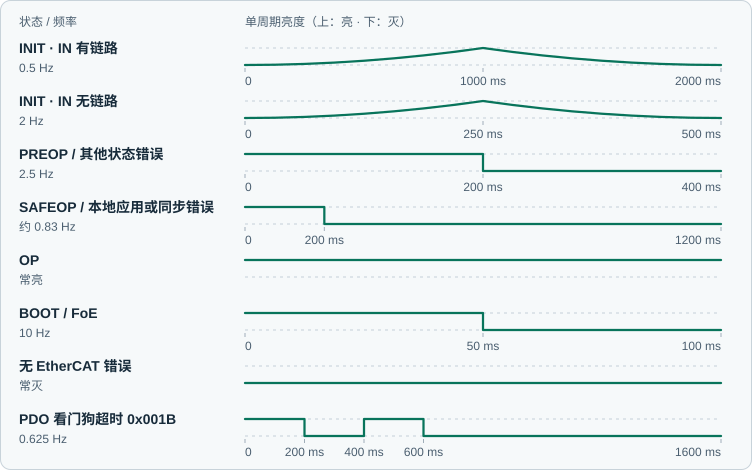
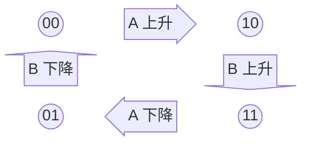

# EM1x30P 数字量输入模块

32 / 16 通道 · 双向输入 · 性能型

本页以 **32 通道版本 EM1430P** 为例讲解，通用产品说明同时适用于 **16 通道版本 EM1230P**。系列名称中的 `x` 为通道数代码：`4` 表示 32 通道，`2` 表示 16 通道。

EM1430P 的独立 DI 固件提供 8 个硬件计数槽。P2 / P3 的端子对可用于独立脉冲计数、正交编码器测位、带方向的脉冲计数，也可接入编码器 Z 相锁存或清零位置。

16 通道版本的接线、计数能力和通道配置以其配套固件、ESI 与实际端子定义为准。后文的 8 槽计数配置及对象索引仅适用于 EM1430P 独立 DI。

## 产品参数

| 参数 | EM1430P（讲解示例） | EM1230P |
| :--- | :--- | :--- |
| 模块类型 | <ModuleBadge kind="DI" /> 数字量输入 | <ModuleBadge kind="DI" /> 数字量输入 |
| 通道数 | 32 | 16 |
| 电气类型 | 双向输入 | 双向输入 |
| 性能型 | 性能型 | 性能型 |
| 产品状态 | 未发布 | 未发布 |
| 连接方式 | EM 背板总线 | EM 背板总线 |
| 配套设备 | IM 耦合器 | IM 耦合器 |

## EM1430P 正面面板

面板上方 P0 / P1 为普通 DI，下方 P2 / P3 可用作 DI 或配对计数输入。底部左侧 **COM** 是 P0 / P1 的公共端，右侧 **COM** 是 P2 / P3 的公共端。图中型号印字沿用实物的 **EM1430**。

<Em1430pPanelDemo>
  
</Em1430pPanelDemo>

## RUN / ERR 指示灯 {#status-leds}

独立 DI 模式下，面板的 **PWR/SYS**（RUN）显示 EtherCAT 运行状态，**ERROR**（ERR）显示错误状态。INIT 的呼吸频率取决于 **IN 口**的物理链路。

| 灯 | 状态 | 频率 | 一个周期的灯效 |
| :--- | :--- | :--- | :--- |
| RUN | INIT，IN 口有链路 | **0.5 Hz** | 2 秒完成一次呼吸 |
| RUN | INIT，IN 口无链路 | **2 Hz** | 0.5 秒完成一次呼吸 |
| RUN | PREOP | **2.5 Hz** | 亮 200 ms，灭 200 ms |
| RUN | SAFEOP | **约 0.83 Hz** | 亮 200 ms，灭 1000 ms |
| RUN | OP | — | 常亮 |
| RUN | BOOT / FoE | **10 Hz** | 亮 50 ms，灭 50 ms |
| ERR | 无 EtherCAT 错误 | — | 常灭 |
| ERR | 本地应用或同步错误 | **约 0.83 Hz** | 亮 200 ms，灭 1000 ms |
| ERR | PDO 看门狗超时 `0x001B` | **0.625 Hz** | 亮 200 ms，灭 200 ms，再亮 200 ms，灭 1000 ms |
| ERR | 其他 EtherCAT 状态错误 | **2.5 Hz** | 亮 200 ms，灭 200 ms |

<figure class="em1430p-led-timing">
  <figcaption>各行显示一个周期，以该行的时间刻度为准。呼吸曲线表示亮度从低到高再回落。</figcaption>
  

    
  

</figure>

## EM1430P 独立 DI 计数接口

本节适用于 TwinCAT 直连的 **EM1430P，固件 v3.2.12，ESI Rev14**。扫描到的设备名为 `EM1430 (32DI P/N)`，产品码 `0x00001432`，Revision `0x0000000E`。通过 IM 耦合器接入时，请查对应耦合器的过程数据映射。

[下载 EM1430P v3.2.12 / Rev14 配套 ESI](/downloads/em1430p/v3.2.12/Pexus-EM1430P-v3.2.12-Rev0000000E.xml)

8 个槽分别对应 P20/P30 至 P27/P37。每槽可选一种计数模式，默认留空。普通 DI 始终占 4 字节，选定计数模式后，模块将计数值附加到输入 PDO。全选 PUL 或使用四组 AB + ZPUL 时，输入 PDO 总长度均为 68 字节。模块的输出 PDO 长度为 0。

| 想测什么 | 在 Slots 中选择 | P2n 接线 | P3n 接线 | 每槽回传 |
| --- | --- | --- | --- | --- |
| 两路脉冲，各自累计 | **PUL** | 第一路脉冲 | 第二路脉冲 | 两个 `UDINT`，共 8 字节 |
| 正交编码器或脉冲轴的位置 | **AB / AB2x / AB4x** | A 相 | B 相 | 一个 `DINT`，4 字节，分别为 1、2、4 倍频 |
| 脉冲和方向分线 | **DIRPUL** | 脉冲 | 方向电平 | 一个 `DINT`，4 字节 |
| 正向和反向各一路脉冲 | **CWCCW** | 加计数脉冲 | 减计数脉冲 | 一个 `DINT`，4 字节 |
| 编码器 Z 相，另加一路独立脉冲 | **ZPUL** | Z 相 | 独立脉冲 | Z 次数 `UDINT`、锁存位置 `DINT`、独立脉冲数 `UDINT`，共 12 字节 |

表中的 `n = 槽号 − 1`。例如 Slot 2 的 `n = 1`，端子就是 P21 和 P31。

## AB 正交计数：沿状态环判断方向和倍率 {#ab-ring}

圆圈中的两位依次为 **A、B** 的逻辑电平。默认配置下，从左上角 `00` 出发，A 先上升，随后 B 上升，状态沿箭头**顺时针**走一圈，位置增加。若 B 先上升，则沿同一状态环**逆时针**走一圈，位置减少。箭头内的边沿名称按顺时针标注。

| 槽位模式 | 在哪些边沿更新位置 | A 领先一圈 `00 → 10 → 11 → 01 → 00` | B 领先一圈 `00 → 01 → 11 → 10 → 00` |
| --- | --- | ---: | ---: |
| **AB**（1 倍频） | 只看 A 上升沿 | +1 | −1 |
| **AB2x**（2 倍频） | A 上升沿和下降沿 | +2 | −2 |
| **AB4x**（4 倍频） | A、B 两相的全部边沿 | +4 | −4 |

这里的一圈是 **A/B 的一个完整电气周期**。例如编码器每机械转一圈输出 1,000 个 A 相周期，选 AB、AB2x、AB4x，每机械转一圈的位置增量分别为 1,000、2,000、4,000，反向时取负值。倍率通过 **Slots** 选择，配置字里的边沿位不改变 AB 倍率。

## TwinCAT 配置与上电恢复 {#twincat-counter}

1. 关闭 TwinCAT XAE，把配套 XML 放入 EtherCAT 设备描述目录（通常为 `C:\TwinCAT\3.1\Config\Io\EtherCAT`）。重新打开 XAE，扫描设备，核对产品码和 Revision。
2. 在 **Slots** 选择接线所对应的槽和模式。到 **Process Data → Inputs** 核对基础 PDO `0x1A00` 及所选计数 PDO，并把变量链接到 PLC。默认配置字为 `0x0000`；按默认极性和边沿计数时，选好模式即可。
3. 如需滤波、反相、选择边沿或设置 Z 动作，先在 **Online** 请求 **PREOP**，再到 **CoE-Online** 写入该槽配置字。每槽一个 `UINT`，子索引 `00`，**单项写入 2 字节**。
4. **PREOP → SAFEOP** 时自动应用。读回对应的 `0x9001～0x9008` 核对生效值，再进入 **OP** 观察计数。留在 PREOP 手动应用时，向 `0x82F0:00` 写入新的非零 `UDINT` 序号，等待 `0x82F1:00 = 0`，并核对 `0x82F2:00` 回显该序号。
5. 需要重启后自动恢复时，保存 Slots 配置，并在 **Startup → New** 为非默认配置字添加 **P→S / PS** 项，SubIndex 填 `0`。例如 `0x8001:00 = 0x0A04` 的 Data 填 `04 0A`。重新启动后核对 `0x9001:00 = 0x0A04`。 [TwinCAT 从站配置说明](https://infosys.beckhoff.com/content/1033/el36xx/1037003019.html)

::: warning 应用配置会影响现有计数
修改任一槽的计数模式或配置字并应用，会清零所有槽的计数。需要保留累计量时，先记录 PLC 当前读数，再修改配置。
:::

### 每槽配置字

| 槽位 | 端子 | PREOP 写配置 `:00` | 读生效值 `:00` | 槽位 | 端子 | PREOP 写配置 `:00` | 读生效值 `:00` |
| --- | --- | --- | --- | --- | --- | --- | --- |
| 1 | P20 / P30 | `0x8001` | `0x9001` | 5 | P24 / P34 | `0x8005` | `0x9005` |
| 2 | P21 / P31 | `0x8002` | `0x9002` | 6 | P25 / P35 | `0x8006` | `0x9006` |
| 3 | P22 / P32 | `0x8003` | `0x9003` | 7 | P26 / P36 | `0x8007` | `0x9007` |
| 4 | P23 / P33 | `0x8004` | `0x9004` | 8 | P27 / P37 | `0x8008` | `0x9008` |

| 位（从 bit0 起） | 设置 | 适用输入 |
| --- | --- | --- |
| bit0、bit1 | `1` 分别反相 P2n、P3n，默认均为 `0` | 所有模式。先反相，再判断计数边沿或方向 |
| bit2、bit3 | `0` 上升沿，`1` 下降沿，分别对应 P2n、P3n | PUL、CWCCW、ZPUL 使用两位；DIRPUL 只用 bit2 选择脉冲边沿。AB 系列按所选倍率取边沿 |
| bit5、bit6 | bit5 开启 Z 清零，bit6 开启 Z 锁存；同时开启时先锁存再清零 | 写在与 ZPUL 配对的 **AB / AB2x / AB4x 槽** |
| bit8～15 | 两路共用滤波等级。`0` 关闭，`1～254` 每级目标 1 µs，`255` 为 327.04 µs | 只影响计数输入。基础 DI 电平和面板通道灯仍显示端子原始逻辑电平 |
| bit4、bit7 | 保留，写 `0` | 所有模式 |

滤波时间受硬件量化影响。例如 100 级的实际滤波时间为 99.84 µs，254 级为 253.44 µs。选择滤波时应同时考虑信号最短的高、低电平持续时间；脉冲过短可能被滤掉。

## 配置案例 {#counter-examples}

以下读数均为**本次动作前后的增量**。先用低速信号核对接线和方向，再接入实际脉冲源。前四例使用不同槽位，可在同一台 EM1430P 上配置。

### 1. PUL：两路传感器独立计数

将传感器一接 **P20**，传感器二接 **P30**，Slot 1 选 **PUL**。要求第一路按下降沿、第二路按上升沿计数，两路都加 10 µs 滤波。

- **写入** `0x8001:00 = 0x0A04`，Startup 填 `04 0A`。高字节 `0A` 选 10 µs，低字节 `04` 只置 bit2。
- **读取** TxPDO `0x1AA0` 内的 `0x6600:00`（P20）和 `0x6601:00`（P30），均为 `UDINT`。
- **验收** 让两路初始均为低。仅将 P20 拉高，第一路增量为 0，拉低后为 +1；仅将 P30 拉高，第二路立即 +1。两路分别送完 3、5 个完整脉冲后，增量应为 **3、5**。

### 2. AB4x：与脉冲轴显示的位置增量对齐

以汇川 521 的本地脉冲轴为例。轴输出选 **AB**，若该轴的本地计数器选“四倍 AB”时与轴指令增量一致，EM1430P 的 Slot 2 也选 **AB4x**。将 A 接 **P21**，B 接 **P31**，按输出电气类型接好 P2/P3 对应的公共端。

- **配置** `0x8002:00 = 0x0000`（默认），位置为 TxPDO `0x1AF1` 中的 `0x6612:00`，PLC 链接 `DINT`。
- **验收** 比较同一段正向运动的**原始计数增量**。若轴侧四倍计数增加 4,000，DI 选 AB4x 应增加 **4,000**；在相同运动下改选 AB2x 为 **2,000**，改选 AB 为 **1,000**。若轴画面显示 mm 或角度，先按轴的比例换算成计数。
- **方向调试** 若绝对值相同、符号相反，先核对 A/B 相序。若需在模块侧反向，可只反相 A，写 `0x8002:00 = 0x0001`（`01 00`），重新应用后再比较增量。

### 3. DIRPUL：脉冲累计，由方向线决定正负

Slot 3 选 **DIRPUL**，脉冲接 **P22**，方向接 **P32**。采用默认 `0x8003:00 = 0x0000`。TxPDO `0x1AC2` 返回 `0x6622:00`（`DINT`）。

保持 DIR=0，送 10 个脉冲上升沿，位置应 **+10**。停发脉冲，将 DIR 固定为 1，再送 4 个上升沿，位置应 **−4**，两段合计 **+6**。若设备的方向约定相反，可写 `0x8003:00 = 0x0002`（`02 00`）只反相 DIR；若只需改数脉冲下降沿，则写 `0x0004`（`04 00`）。

### 4. CWCCW：正反向脉冲分别接线

Slot 4 选 **CWCCW**，正向脉冲接 **P23**，反向脉冲接 **P33**。两路均按下降沿计数，写 `0x8004:00 = 0x000C`（`0C 00`）。TxPDO `0x1AD3` 返回 `0x6632:00`（`DINT`）。

先让 P23 产生 7 个下降沿，位置应 **+7**；再让 P33 产生 3 个下降沿，位置应 **−3**，两段合计 **+4**。

### 5. AB4x + ZPUL：Z 到来时锁存位置并清零

适用于带 A、B、Z 三相信号的编码器。两槽按 **1/2、3/4、5/6、7/8** 固定配对，可任选哪一个放 ZPUL。这里选 Slot 5/6，可与前四例一起使用。

| 槽位 | 接线 | 配置字与 Startup 原始数据 | PLC 读取 |
| --- | --- | --- | --- |
| Slot 5 = **AB4x** | P24=A，P34=B | `0x8005:00 = 0x0060`（`60 00`），开启锁存和清零 | `0x6642:00` 当前位置，`DINT` |
| Slot 6 = **ZPUL** | P25=Z，P35=独立脉冲 | `0x8006:00 = 0x0000`（默认），两路均识别上升沿 | `0x6653:00` Z 次数，`0x6654:00` 锁存位置，`0x6651:00` 独立脉冲数 |

从位置 0 开始，A 领先走 3 个完整周期，当前位置应为 **12**。保持 A/B 不动，给 P25 一个 Z 上升沿，预期读到 **Z 次数 +1、锁存位置 12、当前位置 0**。再给 P35 两个脉冲，独立脉冲数应 **+2**，AB 位置仍为 0。

若只需锁存并连续计数，将 **AB 槽**改为 `0x0040`；只清零用 `0x0020`；只累计 Z 次数用 `0x0000`。Z 的反相、边沿和滤波设置在 **ZPUL 槽**。

## PDO 与 PLC 变量速查

基础输入 `0x1A00` 必选，含 `0x6000:00`（P00～P17）和 `0x6010:00`（P20～P37），各占一个 `UINT`。后者 bit0～7 为 P20～P27，bit8～15 为 P30～P37。可先看这里确认端子电平，再看计数 PDO。

下表 `n = 槽号 − 1`，数据对象的子索引均为 `00`。实际过程数据按主站的 PDO 分配顺序排列。计数按模 `2^32` 回绕，PLC 中须按字段的有符号或无符号类型解释。

| 模式 | TxPDO 索引 | 数据对象索引（依 PDO 顺序） |
| --- | --- | --- |
| PUL | `0x1AA0 + n` | `0x6600 + 0x10×n`、`0x6601 + 0x10×n` |
| AB / AB2x / AB4x | 分别为 `0x1AB0 + n`、`0x1AE0 + n`、`0x1AF0 + n` | `0x6602 + 0x10×n` |
| DIRPUL / CWCCW | 分别为 `0x1AC0 + n`、`0x1AD0 + n` | `0x6602 + 0x10×n` |
| ZPUL | `0x1B00 + n` | `0x6603 + 0x10×n`、`0x6604 + 0x10×n`、`0x6601 + 0x10×n` |

## 常见问题与排查

| 现象 | 核对方法 |
| --- | --- |
| Slots 中看不到 AB2x、AB4x 或 ZPUL | 核对产品码 `0x1432`、ESI Rev14 和扫描到的设备描述。重新载入配套 XML 后再添加模块。 |
| 轴正向运行，DI 增量恰好是预期的 1/4 | 核对 Slots 中的 AB 倍率和轴侧计数单位。轴按 A/B 全部边沿计数时，选 AB4x。 |
| 基础 DI 变化但计数不变 | 确认已进入 OP，检查所选槽、端子、滤波档位和边沿，用宽脉冲低速单步验证。 |
| 选 ZPUL 后进不了 SAFEOP，AL 为 `0x0024` | 检查同一固定槽对中是否已选择 AB、AB2x 或 AB4x。 |
| Z 次数增加但位置未锁存或未清零 | 到 **AB 槽**核对 bit5、bit6 的生效值，并在 ZPUL 槽读取锁存位置。 |
| 配置写入被拒绝或没有生效 | 在 PREOP 以 2 字节写入子索引 `00`，保留位清零。核对 `0x9001～0x9008`。`0x82F1:00` 为 0 表示成功，1 为待处理，2 为参数错误，3 为配置冲突，4 为硬件失败。 |
| 重启后计数模式或配置恢复默认 | 保存 Slots，并在 Startup 的 P→S 阶段下发非默认槽配置字，再核对生效值。 |

[查看数字量输入模块](./) · [返回扩展模块选型表](../Expansion/)

