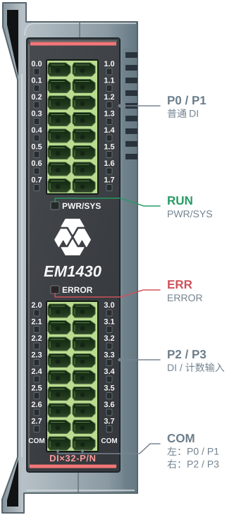

# EM1x30P 数字量输入模块

32 / 16 通道 · 双向输入 · 性能型

本页以 **32 通道版本 EM1430P** 为例讲解，通用产品说明同时适用于 **16 通道版本 EM1230P**。系列名称中的 `x` 为通道数代码：`4` 表示 32 通道，`2` 表示 16 通道。

EM1430P 除数字量输入外，在本文所述独立 DI 固件下支持 PUL、AB、DIRPUL、CWCCW 四种 32 位硬件计数模式，可用于独立脉冲累计、正交编码器位置采集和带方向的位置计数。

16 通道版本的接线、计数能力和通道配置以其配套固件、ESI 与实际端子定义为准。后文的 8 槽计数配置及对象索引仅适用于 EM1430P 独立 DI。

## 产品参数

| 参数 | EM1430P（讲解示例） | EM1230P |
| :--- | :--- | :--- |
| 模块类型 | <ModuleBadge kind="DI" /> 数字量输入 | <ModuleBadge kind="DI" /> 数字量输入 |
| 通道数 | 32 | 16 |
| 电气类型 | 双向输入 | 双向输入 |
| 性能型 | 性能型 | 性能型 |
| 产品状态 | 未发布 | 未发布 |
| 连接方式 | EM 背板总线 | EM 背板总线 |
| 配套设备 | IM 耦合器 | IM 耦合器 |

## EM1430P 正面面板

面板上方 P0 / P1 为普通 DI，下方 P2 / P3 可用作 DI 或配对计数输入。左下端子为 24 V，右下端子为 0 V。图中型号印字沿用实物的 **EM1430**。

<Em1430pPanelDemo>
  
</Em1430pPanelDemo>

## RUN / ERR 指示灯 {#status-leds}

独立 DI 模式下，面板的 **PWR/SYS**（RUN）显示 EtherCAT 运行状态，**ERROR**（ERR）显示错误状态。INIT 的呼吸频率取决于 **IN 口**的物理链路。

| 灯 | 状态 | 频率 | 一个周期的灯效 |
| :--- | :--- | :--- | :--- |
| RUN | INIT，IN 口有链路 | **0.5 Hz** | 2 秒完成一次呼吸 |
| RUN | INIT，IN 口无链路 | **2 Hz** | 0.5 秒完成一次呼吸 |
| RUN | PREOP | **2.5 Hz** | 亮 200 ms，灭 200 ms |
| RUN | SAFEOP | **约 0.83 Hz** | 亮 200 ms，灭 1000 ms |
| RUN | OP | — | 常亮 |
| RUN | BOOT / FoE | **10 Hz** | 亮 50 ms，灭 50 ms |
| ERR | 无 EtherCAT 错误 | — | 常灭 |
| ERR | 本地应用或同步错误 | **约 0.83 Hz** | 亮 200 ms，灭 1000 ms |
| ERR | PDO 看门狗超时 `0x001B` | **0.625 Hz** | 亮 200 ms，灭 200 ms，再亮 200 ms，灭 1000 ms |
| ERR | 其他 EtherCAT 状态错误 | **2.5 Hz** | 亮 200 ms，灭 200 ms |

<figure class="em1430p-led-timing">
  <figcaption>各行显示一个周期，以该行的时间刻度为准。呼吸曲线表示亮度从低到高再回落。</figcaption>
  

    
  

</figure>

## EM1430P 计数接口与适用版本

以下说明面向 **TwinCAT 3 直连独立 DI 模块**的配置场景。

| 项目 | 本文采用的配置 |
| :--- | :--- |
| 产品型号 | EM1430P，32 路双向数字量输入 |
| TwinCAT 设备显示名 | `EM1430 (32DI P/N)` |
| 产品码 | `0x00001432` |
| 固件版本 | v3.2.9 |
| ESI Revision | Rev12（`0x0000000C`） |
| 计数槽位 | 8 槽，默认全部为空，每槽最多选择一种模式 |
| 计数端子 | P20～P27 与 P30～P37，按相同尾号组成 8 对 |
| 计数位宽 | 32 位；PUL 为 `UDINT`，AB / DIRPUL / CWCCW 为 `DINT` |
| 基础输入数据 | 必选 TxPDO `0x1A00`，4 字节，计数启用后仍可读取 DI 电平 |
| 过程数据长度 | RxPDO 为 0 字节；TxPDO 默认 4 字节，最大 68 字节 |

[下载配套 ESI：EM1430P v3.2.9 / Rev12](/downloads/em1430p/v3.2.9/Pexus-EM1430P-v3.2.9-Rev0000000C.xml)

::: warning 版本与接口范围
下文的端子、PDO 和 CoE 索引针对上述独立 DI 接口。通过 IM 耦合器使用扩展模块时，应以对应耦合器和模块的配套说明为准。

v3.2 接口采用 8 槽、32 位计数，不沿用 v3.1 的四槽、64 位配置。Rev12 的模式识别码也与 Rev11 及更早版本不同；迁移旧工程时需载入匹配的 ESI 并重新配置设备。
:::

## 端子分组与计数模式

P0 / P1 用于普通 DI；P2 / P3 可按端子对配置计数，基础 DI 电平仍可读取。以下统一使用 `n = 槽位号 − 1`，取值 `0～7`。例如 Slot 1 对应 P20 / P30，Slot 8 对应 P27 / P37。

| 模式 | P2n 接线 | P3n 接线 | 每槽计数数据 |
| :--- | :--- | :--- | :--- |
| **PUL** | 第一路脉冲 | 第二路脉冲 | 两路独立累计，`2 × UDINT`，8 字节，P2n 在前 |
| **AB** | 编码器 A 相 | 编码器 B 相 | 四倍频位置值，`DINT`，4 字节；默认 A 领先为正 |
| **DIRPUL** | PUL 脉冲 | DIR 方向电平 | 位置值，`DINT`，4 字节；默认 DIR=0 加、DIR=1 减 |
| **CWCCW** | CW 加计数脉冲 | CCW 减计数脉冲 | 位置值，`DINT`，4 字节 |

各槽可独立选择模式，也可留空；同一种模式可以放入多个槽。全部选择 PUL 时，共有 16 路独立脉冲计数；全部选择 AB、DIRPUL 或 CWCCW 时，共有 8 组位置计数。

### PDO 与 PLC 数据类型

| 数据 | TxPDO | 数据对象（子索引均为 `00`） | PLC 类型 |
| :--- | :--- | :--- | :--- |
| 基础 DI，必选 | `0x1A00` | `0x6000`：P00～P17；`0x6010`：P20～P37 | `2 × UINT` |
| PUL | `0x1AA0 + n` | `0x6600 + n×0x10`、`0x6601 + n×0x10` | `2 × UDINT` |
| AB | `0x1AB0 + n` | `0x6602 + n×0x10` | `DINT` |
| DIRPUL | `0x1AC0 + n` | `0x6602 + n×0x10` | `DINT` |
| CWCCW | `0x1AD0 + n` | `0x6602 + n×0x10` | `DINT` |

基础输入对象 `0x6010:00` 的 bit0～7 对应 P20～P27，bit8～15 对应 P30～P37。`0x1C13` 中包含基础 PDO 和最多 8 个计数 PDO；实际过程数据按所选 PDO 顺序排列，槽位不必连续。

计数值按模 `2^32` 回绕。PLC 应按上表链接变量，区分无符号累计值与有符号位置值，并在计算连续增量时处理回绕。

## TwinCAT 3 配置步骤 {#twincat-counter}

### 1. 安装 ESI 并核对设备

1. 下载本页配套的 Rev12 XML，关闭 TwinCAT XAE。
2. 将 XML 放入 `C:\TwinCAT\3.1\Config\Io\EtherCAT`，目录按实际安装位置调整，然后重新打开 XAE。
3. 扫描或添加 DI，在设备的 **EtherCAT** 页核对产品码 `0x1432` 和 Revision `0x0000000C`。设备显示名为 `EM1430 (32DI P/N)`。
4. 若设备使用旧描述或简化的在线描述添加，先加载配套 XML，再重新添加设备。

安装目录和设备描述加载方式见 [Beckhoff ESI 安装说明](https://infosys.beckhoff.com/content/1033/el6751/1036998411.html)。

### 2. 选择槽位并链接过程数据

1. 打开 DI 的 **Slots**，按实际接线选择 Slot 1～8。
2. 在 **Counter mode** 中为所需槽位选择 PUL、AB、DIRPUL 或 CWCCW；每对端子只选择一个模式，未使用的槽位保持为空。
3. 到 **Process Data → Inputs** 核对基础输入 PDO `0x1A00` 和所选计数 PDO。
4. 激活配置，在设备的 **Inputs** 下将计数变量链接到 PLC：PUL 使用 `UDINT`，其余三种模式使用 `DINT`。

模式由 Slots 生成的 PDO 分配决定。`0x8000 + n×0x10` 是只读模式回显，不能通过写入该对象切换模式。

### 3. 在 PREOP 写入 CoE 参数

在 **Online** 页请求 **Pre-Op**，确认 **Current State** 为 PREOP 后，再到 **CoE-Online** 写入参数。下表参数均为 `UDINT`，子索引为 `00`，使用 **4 字节小端的单项 SDO 写入**。

| 槽位 | 端子对 | 滤波对象 | 反向对象 | 边沿对象 |
| :--- | :--- | :--- | :--- | :--- |
| Slot 1 | P20 / P30 | `0x8001` | `0x8002` | `0x8005` |
| Slot 2 | P21 / P31 | `0x8011` | `0x8012` | `0x8015` |
| Slot 3 | P22 / P32 | `0x8021` | `0x8022` | `0x8025` |
| Slot 4 | P23 / P33 | `0x8031` | `0x8032` | `0x8035` |
| Slot 5 | P24 / P34 | `0x8041` | `0x8042` | `0x8045` |
| Slot 6 | P25 / P35 | `0x8051` | `0x8052` | `0x8055` |
| Slot 7 | P26 / P36 | `0x8061` | `0x8062` | `0x8065` |
| Slot 8 | P27 / P37 | `0x8071` | `0x8072` | `0x8075` |

- **滤波**：范围 `0～65408`，单位为滤波时钟周期，同槽两路共用；默认 `0`，表示旁路。此值不是直接以微秒或毫秒表示的时间。
- **反向**：默认 `0`；写 `1` 可反转 AB、DIRPUL、CWCCW 的计数方向，对 PUL 无影响。
- **边沿**：bit0 控制 P2n，bit1 控制 P3n，`0` 为上升沿、`1` 为下降沿。边沿以 DI 逻辑电平为准，输入有效为 `1`。

| 边沿参数值 | P2n | P3n |
| :--- | :--- | :--- |
| `0`（默认） | 上升沿 | 上升沿 |
| `1` | 下降沿 | 上升沿 |
| `2` | 上升沿 | 下降沿 |
| `3` | 下降沿 | 下降沿 |

PUL、CWCCW 使用两位；DIRPUL 仅使用 bit0，写 `0` 或 `1` 选择 PUL 边沿，DIR 始终读取电平；AB 固定对 A / B 两相做四倍频，边沿参数无需设置。

### 4. 应用参数并检查生效值

参数写完后，从 PREOP 进入 SAFEOP 时自动应用，再进入 OP 观察计数。若需要留在 PREOP 调试，可向 `0x82F0:00` 写入一个新的非零应用序号，等待 `0x82F1:00=0`，并确认 `0x82F2:00` 回显该序号。

| 对象（子索引 `00`） | 含义 |
| :--- | :--- |
| `0x82F0` | 应用请求，写入新的非零序号 |
| `0x82F1` | 应用状态：`0` 成功、`1` 待处理、`2` 参数错误、`3` 配置冲突、`4` 硬件失败 |
| `0x82F2` | 最后成功应用的序号 |
| `0x9000 + n×0x10` | 已生效模式：`0` 空、`1` PUL、`2` AB、`3` DIRPUL、`4` CWCCW |
| `0x9001 + n×0x10` | 已生效滤波值 |
| `0x9002 + n×0x10` | 已生效反向值 |
| `0x9005 + n×0x10` | 已生效边沿值 |

例如 Slot 1 的 `0x9000:00=1` 表示 PUL 已生效，`0x9005:00` 可用于核对该槽当前使用的边沿。

::: warning 修改计数配置会清零
修改任意槽的模式、滤波、反向或边沿，应用后会清零所有槽位的计数。调试时应比较配置生效后、每次输入动作前后的计数差。
:::

### 5. 保存到 Startup

在线写入的参数不持久保存，设备重启后恢复空槽和默认参数。需要由主站工程在启动时恢复槽位配置和所需参数。

1. 在 DI 的 **Startup → New** 中添加需要下发的 CoE 参数。
2. Transition 选择 **P→S / PS**，填写对应 Index，SubIndex 填 `0`，每项写入 4 字节小端值。
3. 例如 Slot 1 的边沿参数 `0x8005:00=1`，Data 填 `01 00 00 00`。
4. 保存并激活工程。主站启动时下发配置，设备进入 SAFEOP 时自动应用；随后在 OP 下核对生效值和计数行为。

Startup 中只添加需要下发的可写参数；模式由 Slots / PDO 分配恢复，不要向只读模式回显或 `0x90xx` 生效值对象写入。

TwinCAT 的 Process Data、Startup、Online 与 CoE-Online 页面操作见 [Beckhoff 从站配置说明](https://infosys.beckhoff.com/content/1033/el36xx/1037003019.html)。

## 四种模式配置示例

以下示例分别使用 Slot 1～4，可以同时配置在一块 EM1430P 上。所有参数的子索引均为 `00`，按上述 PREOP 写入、应用、OP 验证的流程执行。

### PUL：两路独立脉冲累计

- **槽位与接线**：Slot 1，两路脉冲分别接 P20、P30。
- **写入参数**：`0x8001=0`、`0x8005=1`。
- **观察数据**：TxPDO `0x1AA0` 中，`0x6600:00` 随 P20 下降沿加 1，`0x6601:00` 随 P30 上升沿加 1，均为 `UDINT`。
- **验证方法**：先只给 P20 送脉冲，再只给 P30 送脉冲；每次应只有对应一路计数变化。

### AB：正交编码器四倍频计数

- **槽位与接线**：Slot 2，A 相接 P21，B 相接 P31。
- **写入参数**：`0x8011=0`、`0x8012=0`，无需设置边沿。
- **观察数据**：TxPDO `0x1AB1` 中的 `0x6612:00`，类型为 `DINT`。
- **验证方向**：A 领先时，一个完整 A / B 周期加 4；B 领先时减 4。需要交换正负方向时写 `0x8012=1` 并重新应用。

以 `(A,B)` 表示 DI 逻辑电平、反向值为 `0`，可按以下顺序单步核对：

| 相序 | 电平变化 | 计数差 |
| :--- | :--- | :--- |
| A 领先 | `00 → 10 → 11 → 01 → 00` | `+4` |
| B 领先 | `00 → 01 → 11 → 10 → 00` | `−4` |

### DIRPUL：脉冲加方向

- **槽位与接线**：Slot 3，PUL 接 P22，DIR 接 P32。
- **写入参数**：`0x8021=0`、`0x8022=0`、`0x8025=0`。
- **观察数据**：TxPDO `0x1AC2` 中的 `0x6622:00`，类型为 `DINT`；DIR=0 时每个 PUL 上升沿加 1，DIR=1 时减 1。
- **验证方法**：先保持 DIR 电平稳定，再发送脉冲；切换 DIR 后重复验证。需要按下降沿计数时，写 `0x8025=1` 并重新应用。

### CWCCW：双脉冲加减计数

- **槽位与接线**：Slot 4，CW 接 P23，CCW 接 P33。
- **写入参数**：`0x8031=0`、`0x8032=0`、`0x8035=3`。
- **观察数据**：TxPDO `0x1AD3` 中的 `0x6632:00`，类型为 `DINT`；每个 CW 下降沿加 1，每个 CCW 下降沿减 1。
- **验证方法**：分别给两路送脉冲，先确认增减方向，再接入实际信号。

## 常见问题与排查

| 现象 | 核对与处理 |
| :--- | :--- |
| 看不到 Slots 或四种模式 | 核对产品码 `0x1432`、Rev12 与配套 ESI；使用旧描述添加的设备需用配套 XML 重新添加。 |
| 已选择槽位，Inputs 中没有计数变量 | 核对 Process Data 中的计数 PDO，激活工程；每对端子只选一个模式。 |
| 基础输入不变化 | 观察 `0x6010:00` 或基础输入 PDO，检查信号源、输入公共端和端子；P20～P27 为 bit0～7，P30～P37 为 bit8～15。 |
| 输入变化但计数不变 | 确认进入 OP，核对 `0x90xx` 生效模式与边沿；使用低速脉冲单步验证。滤波过长可能滤掉短脉冲。 |
| 参数写入失败或生效值不变 | 确认处于 PREOP，使用子索引 `00` 和 4 字节单项写入；检查 `0x82F1:00` 状态和 `0x82F2:00` 序号回显。 |
| AB 每周期增加 4，或位置方向相反 | AB 为四倍频，每个完整周期计 4 次；核对 A / B、PUL / DIR 或 CW / CCW 接线及反向参数。 |
| 修改一个槽位后，其他槽计数也归零 | 修改模式、滤波、反向或边沿后，应用配置会清零所有计数。 |
| 断电重启后配置丢失 | 在线参数不持久保存；在主站工程中保存 Slots 配置，并在 Startup 的 PS 阶段下发所需参数。 |

上述示例用于低速功能验证，不作为最高输入频率、滤波截止频率或时序抖动的性能指标。

[查看数字量输入模块](./) · [返回扩展模块选型表](../Expansion/)

