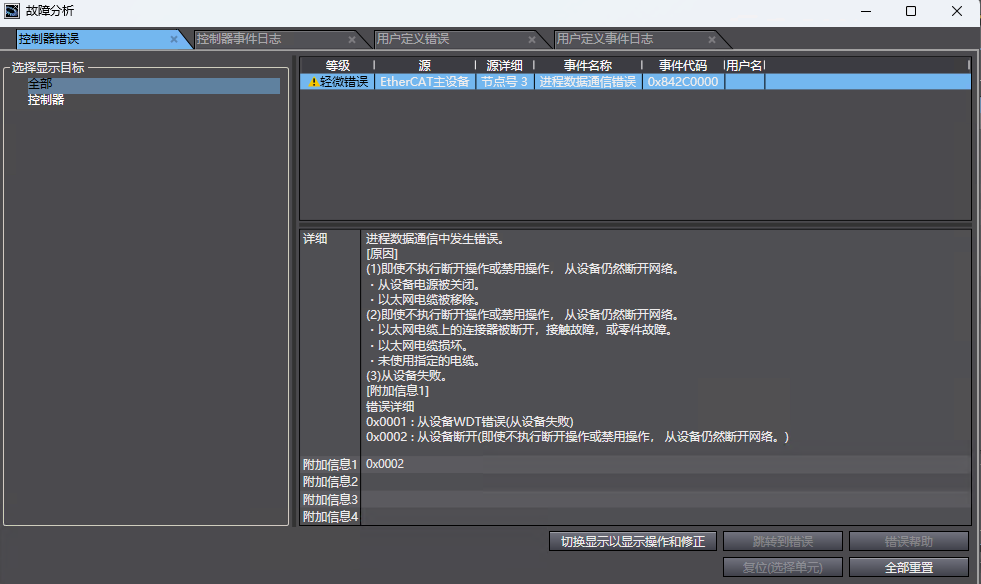

# 欧姆龙 NX1P2 拔插 EtherCAT 网线后如何恢复通信

在 NX1P2-1140DT 台架上，运行中拔掉 EtherCAT 网线再插回，PLC 仍报告“进程数据通信错误”。在 Sysmac Studio 中复位错误后，I/O 恢复刷新。使用 Pexus 从站和其他品牌从站分别测试，均复现了这一现象。

对于下图的 **`0x842C0000`，附加信息 1 为 `0x0002`**，欧姆龙将其定义为从站意外离网，事件来源是 EtherCAT 主站，恢复方式为错误复位。网线接回后，需先确认从站重新入网，再复位主站错误。跨品牌对照也表明，此现象本身不足以判定耦合器固件异常。[欧姆龙《NJ/NX 系列故障排除手册》W503](https://files.omron.eu/downloads/latest/manual/en/w503_nj_nx-series_troubleshooting_manual_users_manual_en.pdf)



## 在 Sysmac Studio 中确认并恢复

1. **确认节点和附加信息。** 打开“故障分析 → 控制器错误”，查看“源详细”和“附加信息 1”。图中的节点号是 3。`0x0002` 表示从站意外离网；同一事件码下，`0x0001` 表示从站看门狗错误，应按对应原因排查。
2. **确认从站重新入网。** 接回网线，在监视表中查看 `_EC_EntrySlavTbl[3]`。它变为 `TRUE` 表示节点 3 已重新加入网络。若拔掉的是两台从站之间的线，PLC 主端口的 `_EC_LinkStatus` 可能始终为 `TRUE`，此时要检查断点下游各节点的入网状态。
3. **复位并确认 I/O 刷新。** 确认受影响的从站都已入网、现场允许恢复输出后，在故障分析窗口复位 EtherCAT 主站错误。观察 `_EC_PDSlavTbl[3]` 是否恢复为 `TRUE`，再确认实际 I/O 更新。现场使用其他节点号时，把下标 `3` 换成工程配置的节点地址。

如果入网标志持续为 `FALSE`，先检查断点下游第一台从站的供电、网线和端口连接。如果已经入网，但复位后过程数据仍未恢复，检查从站的 EtherCAT 状态和 AL 状态码。[欧姆龙《CPU 单元内置 EtherCAT 端口用户手册》W505](https://www.omron-ap.com/data_pdf/mnu/w505-e1-33_nx_nx1p_nj.pdf)

## 100 ms 周期任务自动复位

以下 ST 适用于 NX1P2 台架上的拔插测试。程序每 100 ms 检查一次 EtherCAT 错误，对所有站号使用同一逻辑。检测到错误且复位功能块空闲时，当拍发出复位请求。错误持续时，两次请求之间留一个任务周期的低电平，让 `Execute` 产生新的上升沿，因此最快每 200 ms 重试一次。错误清除后停止发出请求。程序由任务调度执行，无需定时器或计数器。[欧姆龙《NJ/NX 系列指令参考手册》W502](https://files.omron.eu/downloads/latest/manual/en/w502_nj_nx-series_instructions_reference_manual_en.pdf)

### 在 Sysmac Studio 中配置

1. 在 **编程 → POU → 程序** 下新建独立的 ST 程序 `EC_AutoReset`。
2. 在该程序的局部变量表添加以下四项，均关闭保持属性。

   | 变量名 | 数据类型 | 初始值 |
   | :--- | :--- | :--- |
   | `EcResetFB` | `ResetECError` | 默认 |
   | `EcLevel` | `UINT` | `0` |
   | `EcCode` | `DWORD` | `0` |
   | `ResetPulse` | `BOOL` | `FALSE` |

3. 将以下代码粘贴到 ST 正文。

   ```text
   ResetPulse := GetECError(EcLevel, EcCode) AND NOT EcResetFB.Busy AND NOT ResetPulse;
   EcResetFB(Execute := ResetPulse);
   ```

4. 在 **配置和设置 → 任务设置** 中，将 `EC_AutoReset` 分配到优先级 **17 或 18** 的 **100 ms 周期任务**。任务周期须为主周期任务的整数倍。例如，主周期为 8 ms 时，可选 96 ms，ST 无需修改。工程中原有的手动或自动复位逻辑若也调用 `ResetECError`，应与此程序互锁，避免同时请求复位。[欧姆龙《NJ/NX 系列 CPU 单元软件用户手册》W501](https://files.omron.eu/downloads/latest/manual/en/w501_nj_nx-series_cpu_unit_software_users_manual_en.pdf?v=3)

::: warning 复位范围与适用条件

`ResetECError` 作用于整个 EtherCAT 主站功能模块。此台架示例只按主站错误状态触发，线缆仍断开时也会尝试复位。正式设备应按欧姆龙手册先确认受影响的从站已经重新入网，并将设备的运行许可纳入复位条件。[欧姆龙《NJ/NX 系列故障排除手册》W503](https://files.omron.eu/downloads/latest/manual/en/w503_nj_nx-series_troubleshooting_manual_users_manual_en.pdf)

:::

### 验证拔插恢复

1. 先确认受测节点的 `_EC_PDSlavTbl[节点号]` 为 `TRUE`，且 I/O 正在更新。
2. 拔下网线后，观察 `EcCode` 和 `ResetPulse`。复位功能块的当前状态可在监视表查看 `EcResetFB.Busy`、`EcResetFB.Error` 和 `EcResetFB.ErrorID`。
3. 接回网线，确认 `_EC_EntrySlavTbl[节点号]` 先变为 `TRUE`，随后 `_EC_PDSlavTbl[节点号]` 恢复为 `TRUE`，实际 I/O 恢复刷新。若一直没有重新入网，按上文排查断点下游的供电、线缆和端口。[欧姆龙《CPU 单元内置 EtherCAT 端口用户手册》W505](https://www.omron-ap.com/data_pdf/mnu/w505-e1-33_nx_nx1p_nj.pdf)

跨品牌台架已验证意外掉线和手动复位现象。以上 ST 已做本地扫描逻辑模拟，实际工程的编译、下载和拔插验证仍需在 Sysmac Studio 中完成。
