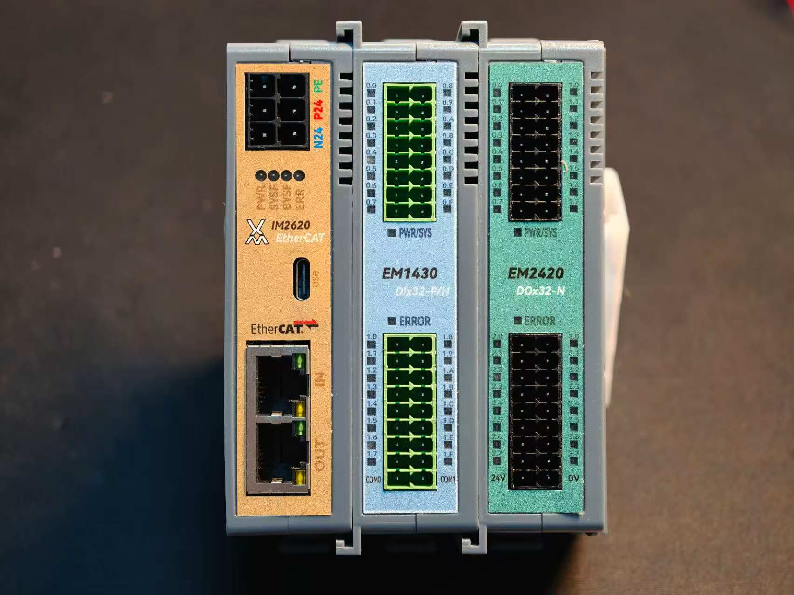
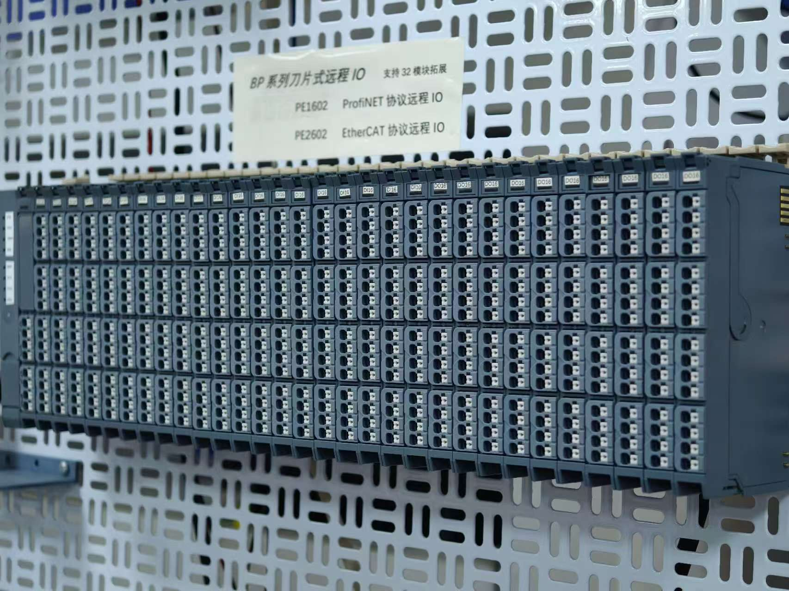

# Pexus Edge 远程IO系统

::: tip 系列归属
本页面为 **Pexus 标准自动化控制平台**之 **Pexus Edge** 系列（分布式远程 I/O）技术规格总览。Pexus Edge 包含 **IM 通讯耦合器**与 **EM 背板总线扩展模块**两大类，是整线数据采集与控制的现场层基石。平台总览请见 [Pexus 标准自动化控制平台](../)。
:::

小美技术 Pexus Edge 远程 I/O 产品线丰富多样，为工业数据采集与控制提供灵活高效的分布式解决方案，适配不同空间布局与安装需求，满足从简单到复杂的信号接入。凭借卓越的稳定性、灵活的配置性及强大的定制能力，Pexus Edge 已成为汽车、电力、冶金、水处理、智能装备等众多行业提升自动化水平、实现智能感知的可靠基石。

<!-- Use it like any other HTML element -->
<model-viewer
  src="/models/im2620c-ec.glb" 
  ar ar-modes="webxr scene-viewer quick-look"
  camera-orbit="30.85deg 42.39deg 0.2632m" field-of-view="30deg"
  alt="3D模型"
  auto-rotate
  camera-controls
  exposure="0.5"
  shadow-intensity="1"
  environment-image="neutral"
  tone-mapping="aces"
  ambient-occlusion-intensity="1"
  min-camera-distance="0.5"
  max-camera-distance="10"
  style="width: 100%; height: 400px;"
></model-viewer>

## 技术规格

### 1. 通讯模块 (耦合器) 规格表

| 规格参数 | <ModuleBadge kind="IM" protocol="PN" label="Pexus Edge PN" /> | <ModuleBadge kind="IM" protocol="EC" label="Pexus Edge EC" /> | <ModuleBadge kind="IM" label="Pexus Edge MT" /> |
| :--- | :--- | :--- | :--- |
| **型号** | **IM1620-PN** | **IM2620-EC** | **IM3620-MT** |
| 组态方式 | PROFINET | EtherCAT | ModbusTCP |
| 级联拓扑数 | ≤65534 | ≤65534 | ≤16 |
| I/O模块数 | ≤32 | ≤32 | ≤32 |
| 通讯字节数 | 1024byte输入 1024byte输出 | 1024byte输入 1024byte输出 | 1024byte输入 1024byte输出 |
| 传输速率 | 100Mbps | 100Mbps | 100Mbps |
| 接口结构 | RJ45 | RJ45 | RJ45 |
| 站点距离 | ≤100m | ≤100m | ≤100m |
| 电源输入 | 18-36VDC | 18-36VDC | 18-36VDC |
| 电源输出 | 5VDC | 5VDC | 5VDC |
| 输出功耗 | 3500mA | 3500mA | 3500mA |
| 报警信息 | I/O错误与变动报警 | I/O错误与变动报警 | I/O错误与变动报警 |
| 工作温度 | -25~85°C | -25~85°C | -25~85°C |
| 存储温度 | 0~55°C | 0~55°C | 0~55°C |
| 防护等级 | IP20 | IP20 | IP20 |

## 耦合器与扩展模块选型

[查看耦合器与扩展模块选型表](./Expansion/)，按型号、功能、通道数、信号或协议查询。

数字量模块的 32 通道与 16 通道版本合并为系列文档，默认以 32 通道讲解。详见 [DI 系列文档](./DI/#系列文档) 和 [DO 系列文档](./DO/#系列文档)；系列名称中的 `x=4` 表示 32 通道，`x=2` 表示 16 通道。

::: details 数字量输入模块规格

| <ModuleBadge kind="DI" /> | 规格参数 | EM1430 (32 通道) | EM1230 (16 通道) |
| :--- | :--- | :--- | :--- |
| **电源规格** | **电流消耗** | 25mA | 25mA |
| | **输入电压** | 24VDC | 24VDC |
| | **允许范围** | 24VDC (±25%) | 24VDC (±25%) |
| **输入特性** | **通道数** | 32 | 16 |
| | **输入信号类型** | PNP / NPN | PNP / NPN |
| | **输入额定电压** | 24VDC (±20%) / 0VDC (±3V) | 24VDC (±20%) / 0VDC (±3V) |
| | **输入逻辑1值** | 15~30V / -3~3V | 15~30V / -3~3V |
| | **输入逻辑0值** | -3~3V / 15~30V | -3~3V / 15~30V |
| | **去抖动时间** | 可配置0-20ms，默认3ms | 可配置0-20ms，默认3ms |
| | **输入电流典型值** | 4mA | 4mA |
| | **隔离耐压** | 500V | 500V |
| | **隔离方式** | 光耦隔离 | 光耦隔离 |
| **物理特性** | **尺寸规格** | 100 * 68 * 12 mm | 100 * 68 * 12 mm |
| | **工作温度** | -25~85°C | -25~85°C |
| | **存储温度** | 0~55°C | 0~55°C |
| | **防护等级** | IP20 | IP20 |

:::

::: details 数字量输出模块规格

| <ModuleBadge kind="DO" /> | 规格参数 | EM2410 / EM2420 (32 通道) | EM2210 (16 通道) |
| :--- | :--- | :--- | :--- |
| **电源规格** | **电流消耗** | 68mA | 待确认 |
| | **输入电压** | 24VDC | 24VDC |
| | **允许范围** | 24VDC (±25%) | 24VDC (±25%) |
| **输出特性** | **通道数** | 32 | 16 |
| | **输出信号类型** | PNP(EM2410) / NPN(EM2420) | PNP |
| | **输出额定电压** | 24VDC (±20%) / 0VDC (±3V) | 24VDC (±20%) / 0VDC (±3V) |
| | **驱动能力** | 单通道500mA | 单通道500mA |
| | **负载类型** | 阻性、感性、灯负载 | 阻性、感性、灯负载 |
| | **隔离耐压** | 500V | 500V |
| | **隔离方式** | 光耦隔离 | 光耦隔离 |
| **物理特性** | **尺寸规格** | 100 * 68 * 12 mm | 100 * 68 * 12 mm |
| | **工作温度** | -25~85°C | -25~85°C |
| | **存储温度** | 0~55°C | 0~55°C |
| | **防护等级** | IP20 | IP20 |

:::

### 温度(RTD)输入模块规格表

| <ModuleBadge kind="OTHER" label="RTD" /> | 规格参数 | 参数值 |
| :--- | :--- | :--- |
| **基本信息** | **型号 / 名称** | - / 4通道热电阻(RTD)输入模块 |
| **电源规格** | **电流消耗** | 230mA / 250mA |
| **输入特性** | **通道数** | 4 |
| | **接线方式** | 2线/3线/4线制 (默认 3线制) |
| | **传感器类型** | PT100/电阻测量/电位器 |
| | **冷端补偿** | 无 |
| | **分辨率** | 0.1°C / 数位 |
| | **精度** | 0.02% |
| | **隔离耐压** | 现场侧和数字侧500V，通道间不隔离 |
| **物理特性** | **尺寸规格** | 100 * 68 * 12 mm |
| | **工作温度** | -25~85°C |
| | **存储温度** | 0~55°C |
| | **防护等级** | IP20 |

# 3D图纸下载
## 耦合器
## IO模块

## BP系列 （刀片式）

